<div align="center">

# WristFlow

**从界面交互到板载传感器，逐步做一块可运行的智能手表。**

基于立创黄山派与 LVGL 的个人手表原型，探索日常交互与低功耗。

[实机图集](#device-gallery) · [界面设计](#gallery) · [快速开始](#start) · [硬件平台](#hardware) · [工程结构](#structure) · [开发进展](#milestones)

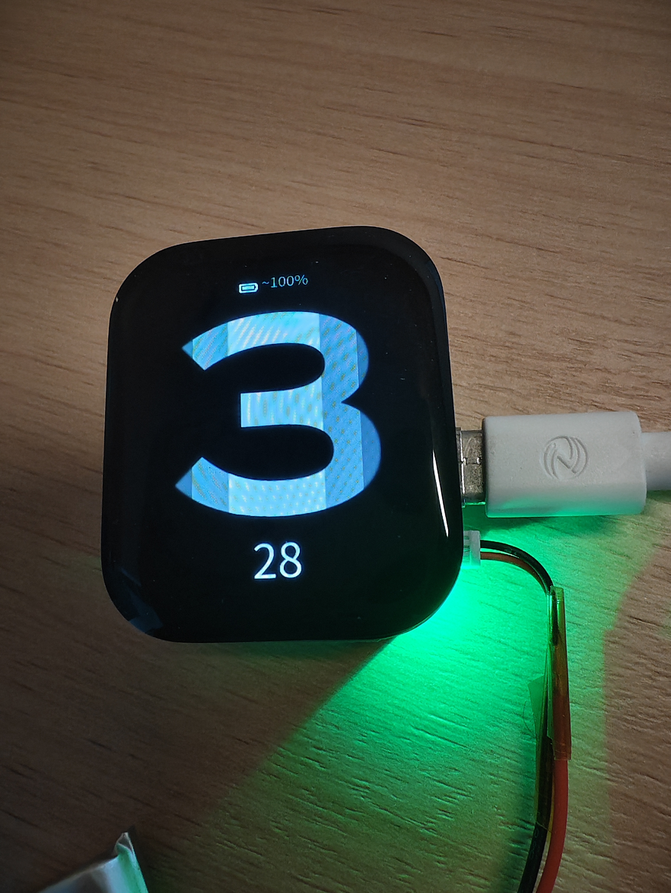

WristFlow 原型实拍 · 表盘

</div>

WristFlow 从表盘与组件开始，逐步接入手机通知、天气、计时应用、原生计步、翻腕亮屏、AOD、自动亮度和未校准指南针。项目运行在实际开发板上，也提供 Windows PC 界面模拟器。

目前是持续迭代的原型。界面、编译和实机结果分别记录；电量准确度、物理深睡电流与整机续航仍待测量。功能入口中的找手机、排水等占位项目见下方说明。

<a id="device-gallery"></a>
## 运行在实际设备上

下面是2026年10月25日提供的原型照片，展示控制中心、活动页面、倒计时和AOD。照片保留实际接线、`0`与`--`等显示；`~100%`是电压估算值。

<p align="center">
  <a href="docs/media/control-center-device.jpg">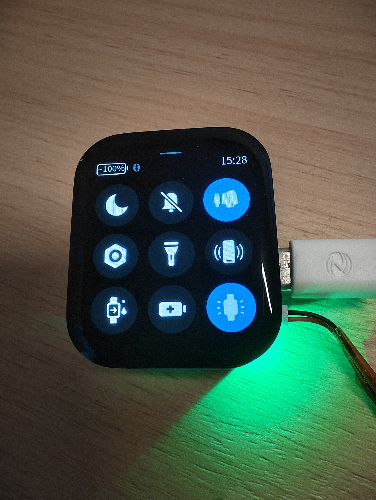</a>
  <a href="docs/media/activity-device.jpg">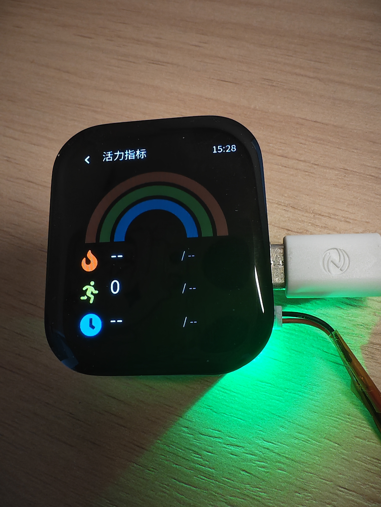</a>
</p>

<p align="center"><b>控制中心 · 活动页面</b></p>

<p align="center">
  <a href="docs/media/countdown-device.jpg">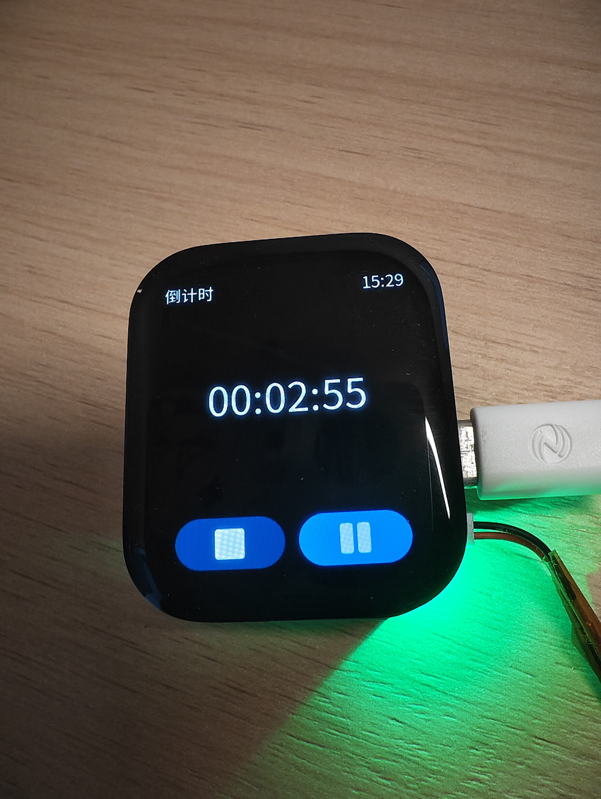</a>
  <a href="docs/media/aod-device.jpg">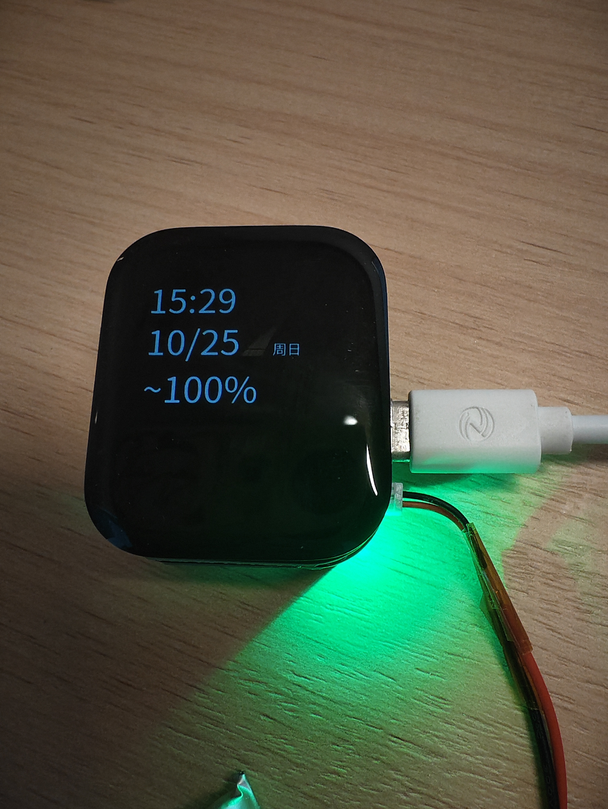</a>
</p>

<p align="center"><b>倒计时 · AOD</b></p>

<a id="gallery"></a>
## 界面设计

下面是项目自身的主机 LVGL／UI Demo 截图，点击可看原图。时间、活动数值、图表和305°航向属于演示输入；画面不是设备照片，也不表示所有显示指标已有真实算法。

<p align="center">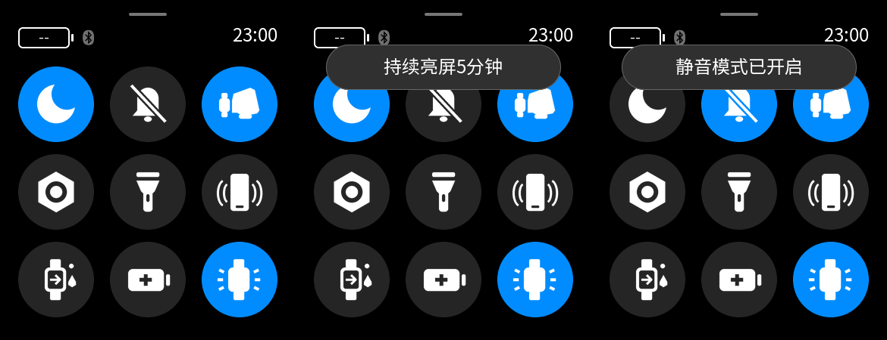</p>

<p align="center"><b>控制中心状态与提示</b></p>

<p align="center">
  <a href="docs/media/activity.png">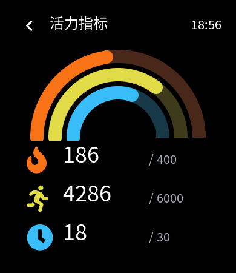</a>
  <a href="docs/media/steps.png">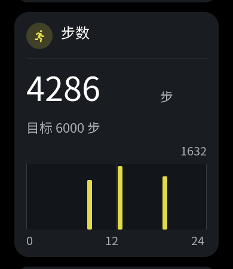</a>
</p>

<p align="center"><b>活力指标总览 · 步数与小时分布</b></p>

<p align="center">
  <a href="docs/media/countdown-picker.png">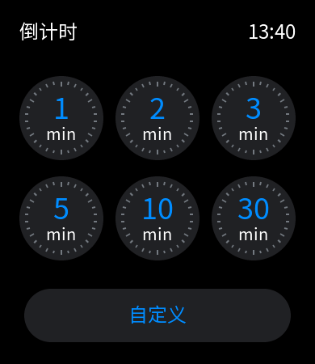</a>
  <a href="docs/media/countdown-running.png">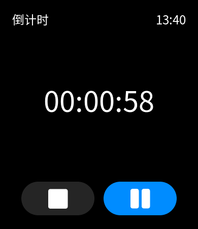</a>
</p>

<p align="center"><b>倒计时预设 · 运行与暂停（早期主机渲染）</b></p>

图中预设蓝底属于历史快照；当前XML预设已采用中性灰底，数字仍保留蓝色。素材按原样保留，后续以同版渲染更新。

<p align="center">
  <a href="docs/media/brightness.png">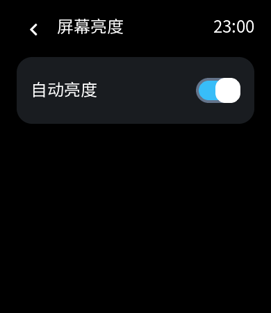</a>
  <a href="docs/media/compass.png">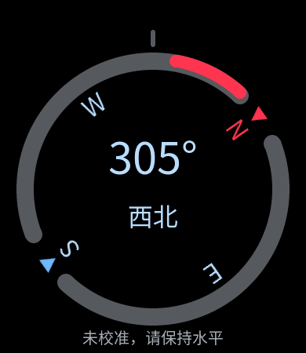</a>
</p>

<p align="center"><b>自动亮度设置 · 未校准指南针</b></p>

照片与截图的来源和适用范围见[素材说明](docs/media/README.md)。

## 能做什么

| 功能 | 已有内容与当前边界 | 进一步了解 |
|---|---|---|
| 表盘与组件 | 滑动组件、表盘与布局选择、设置保存；数据缺失显示未知 | [交互与应用](docs/UI-APPS.md)、[布局保存](docs/PRODUCT-SETTINGS.md) |
| 手机连接 | 基于 Gadgetbridge 的有界测试扩展，接收通知、时间和天气；通知只展示实际收到的内容 | [连接与协议](docs/BLE-FIRST-LINK.md)、[通知界面](docs/NOTIFICATION-UI.md) |
| 计时与提醒 | 闹钟、倒计时、秒表，以及呼吸引导、2048等独立页面 | [闹钟](docs/ALARM.md)、[倒计时](docs/COUNTDOWN.md)、[呼吸](docs/BREATHING.md)、[2048](docs/GAME-2048.md) |
| 活动与计步 | 原生计步、今日总量、小时分布及保存；卡路里、站立和活动强度等算法仍待接入 | [活力与计步](docs/ACTIVITY.md) |
| 显示与唤醒 | 控制中心、翻腕亮屏、AOD、长续航模式和自动亮度，已有分版本实机记录；省电收益仍待测量 | [控制中心](docs/CONTROL-CENTER.md)、[AOD](docs/AOD.md)、[长续航](docs/ENDURANCE.md)、[亮度](docs/PRODUCT-SETTINGS.md#automatic-brightness-20261024) |
| 指南针 | 前台未校准 XY 航向与相对转向响应；八字校准、安装零点和倾斜补偿待完成 | [指南针](docs/COMPASS.md) |

控制中心的**找手机、排水**目前只有图标；**静音**保存独立偏好，音频业务待接入。健康与睡眠相关布局也不能据界面推断真实测量能力。各版本的实际验证条件见对应专题，完整状态入口为 [STATUS](docs/STATUS.md#current)。

<a id="start"></a>
## 快速开始

### 先在电脑上查看界面

当前主机入口面向 Windows。先按[模拟器说明](docs/SIMULATOR.md#启动)准备 PowerShell 7、CMake、Ninja、UCRT64 GCC 和锁定的 SDK，再在仓库根目录运行：

```powershell
pwsh -NoProfile -ExecutionPolicy Bypass -File .\scripts\Simulate.ps1
```

脚本会构建主机程序、运行 CTest，再打开可用鼠标交互的模拟器。UI Demo 使用演示数据；传感器、BLE和电源行为仍由目标板验证。详细依赖和路径设置见[模拟器说明](docs/SIMULATOR.md)，VS Code 入口见[任务说明](docs/VSCODE.md)。

### 在黄山派上开发

1. 参考[构建说明](docs/BUILD.md#当前机器直接使用)准备固定 SDK 和官方 SCons 环境；已有环境直接复用。
2. 编译日常产品固件：

   ```powershell
   pwsh -NoProfile -File .\scripts\Build.ps1 -Example product -Jobs 4
   ```

3. 按[硬件与供电说明](docs/HARDWARE.md)核对实际板屏和接线，再进入[下载流程](docs/FLASHING.md#current-flash-entry)。构建与下载分开执行。

### 从一个小改动开始参与

先读[项目规则](AGENTS.md)，再由[任务索引](PROJECT_INDEX.md)找到目标模块。可以从文档与素材、UI交互、主机回归或板载器件适配开始；验证和 PR 流程见[贡献说明](CONTRIBUTING.md)。

<a id="hardware"></a>
## 硬件平台

| 项目 | 当前平台 |
|---|---|
| 开发板 | 立创黄山派 SF32LB52-ULP，板型由 [SDK锁](sdk.lock.json)固定 |
| 显示与触控 | 390×450 AMOLED，CO5300／FT6146 |
| 已接入的板载能力 | 原生计步与腕部事件、LTR-303环境光、MMC5603NJ地磁 |
| 供电 | 已有原电池独立供电及 USB 条件下的分版本记录，接线与实际条件见[硬件文档](docs/HARDWARE.md) |
| 固件与界面 | 锁定的 SiFli-SDK、官方 SCons、LVGL 9.4.0；UI设计源使用官方 XML 编辑／导出流程 |

项目当前基于现成开发板与屏幕集成。音频、TF等资源的后续路线见[板载资源规划](docs/BOARD-RESOURCES.md)。

<a id="structure"></a>
## 项目放在哪里

```text
apps/                    固件与模拟器入口
  product/               日常产品固件
  ui_demo/               固定数据的界面演示
  bringup/               板级诊断
  simulator/             Windows界面模拟器
core/                    平台无关的模型、协议与状态逻辑
ui/                      界面设计与交互
  xml/                   XML设计源与官方生成输出
  runtime/               手写的数据绑定、路由和生命周期
integrations/gadgetbridge/ 手机端上游的小补丁及测试构建入口
scripts/                 构建、模拟器、实验采集与离线回放工具
tests/                   主机测试与回放夹具
docs/                    硬件、功能、工程地图及验证记录
vendor/SiFli-SDK/        固定版本的厂商SDK及其依赖
```

找具体代码及修改边界时使用[工程地图](docs/ENGINEERING-MAP.md)，按任务查资料使用[PROJECT_INDEX](PROJECT_INDEX.md)。XML和官方生成 C 分工见[界面工作流](docs/UI-DEMO.md)。

## 各部分怎样配合

| 部分 | 负责什么 |
|---|---|
| 界面 | XML描述页面，手写适配层处理交互并绑定数据 |
| 核心逻辑 | 维护计时、配置、协议与状态规则，提供主机可验证的逻辑 |
| 产品固件 | 连接 RTC、保存、传感器、BLE与电源等板端服务 |
| 手机端集成 | 基于 Gadgetbridge 测试扩展传入通知、时间与天气 |
| 验证工具 | 主机测试、模拟器、历史字节回放及有界实机记录分别提供证据 |

更详细的设计见[产品入口](docs/PRODUCT-RUNTIME.md)、[UI运行框架](docs/UI-RUNTIME.md)和[目标架构](docs/ARCHITECTURE.md)。

<a id="milestones"></a>
## 持续迭代

以下是已发生的阶段记录，当前任务与下一步统一在 [STATUS](docs/STATUS.md#current) 维护。

| 阶段 | 代表进展 |
|---|---|
| 2026年9月 | 固定SDK与构建基线，完成界面演示和Windows模拟器入口 |
| 10月上旬 | 通知与天气、闹钟、倒计时、呼吸等功能逐步集成 |
| 10月中旬 | 电池页面、充电显示、原生计步保存及翻腕亮屏 |
| 10月22–25日 | 控制中心、长续航、AOD、自动亮度和未校准指南针；实验工具收敛为可复用入口 |

完整变更可查[提交记录](https://github.com/e-n-ye/wristflow/commits/main/)与[已合并PR](https://github.com/e-n-ye/wristflow/pulls?q=is%3Apr+is%3Amerged)。电流与续航、指南针校准以及更多板载资源仍有待验证或实现。

## 许可与致谢

仓库自有代码的许可证尚待明确。第三方代码与资源各自保留原许可：SiFli-SDK根许可证为 Apache-2.0，所用 LVGL core 为 MIT，Noto与Font Awesome字体子集的来源和OFL说明见[字体说明](ui/xml/fonts/README.md)，图像资源来源见[图片说明](ui/xml/images/README.md)。SDK内其他组件也应查看各自许可文件。

手机端基于 Gadgetbridge 上游维护有界测试扩展，介绍和来源见[集成说明](integrations/gadgetbridge/README.md)。LVGL编辑器许可与图形库许可分别说明在[编辑器文档](docs/LVGL-PRO.md)。

感谢 SiFli-SDK、LVGL、Gadgetbridge 及字体／图标项目。展示组织参考 InfiniTime、SmartKnob、wasp-os、ElectronBot、X-TRACK 和 Monica 等项目，取舍与来源保存在[展示记录](docs/REPOSITORY-SHOWCASE.md)；本页图集均来自 WristFlow 自身记录。
