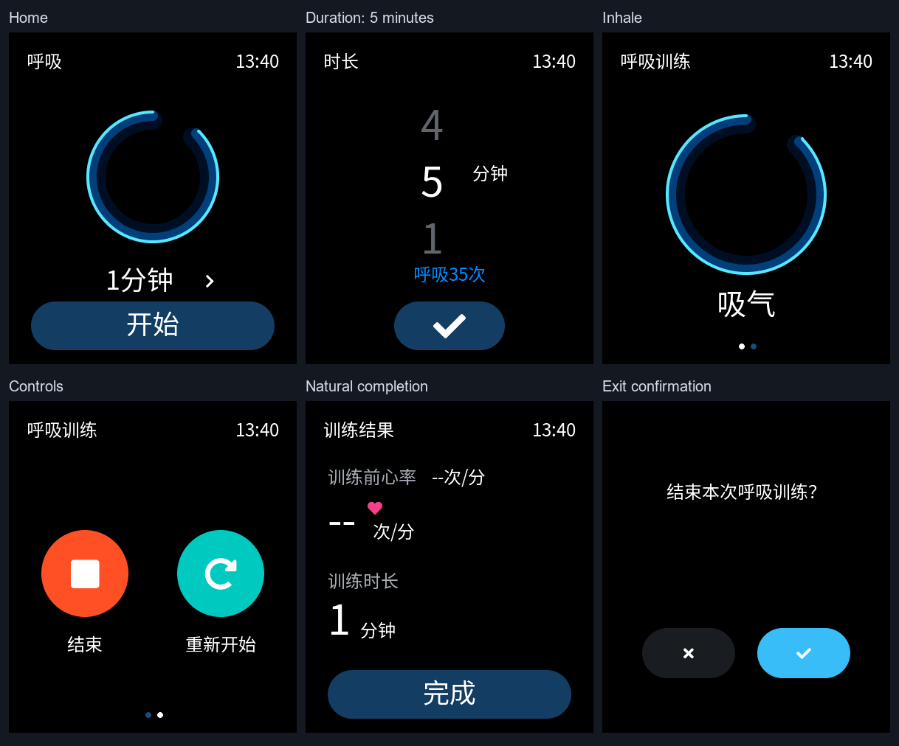
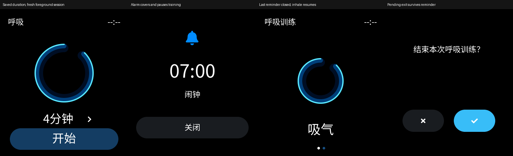
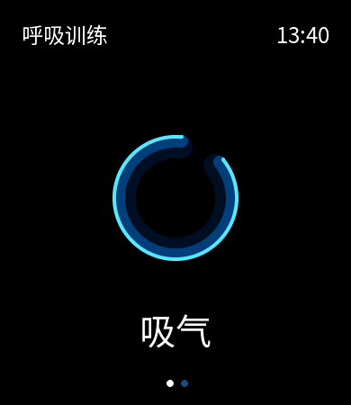

# 呼吸训练

## 已确认契约（2026-10-11，Q1–Q12）

用户参考照片决定视觉，目标 390×450。菜单“呼吸训练”，主页“呼吸”。时长无限滚轮选择 1–5 分钟，首次 1 分钟，勾确认、返回放弃；记住确认值，跨重启保存的接线与证据见[第二轮](#round2)。

每分钟 7 个完整吸呼循环，吸呼等长，无屏息，开始直接吸气。圆环吸气放大、呼气缩小；2026-10-12 用户补充吸气顺时针、呼气逆时针旋转，接入记录见[第三轮](#round3)。动画与“结束／重新开始”两页左右切换，切页继续计时。“结束”回主页，不产生结果；“重新开始”立即清零，沿用时长，从吸气开始并回动画页。仅自然完成进入结果，训练前／后心率均为 `--`，显示训练时长；“完成”回主页。没有训练历史或模拟 PPG 值。

训练期间按用户亮度常亮，其他页面普通息屏。主动离开先确认，确认期间暂停；取消从吸气继续，确认停止并去目标。离页／重启不恢复运行中的训练。普通消息只入库、不弹提示；闹钟／倒计时覆盖期间暂停，全部提醒关闭后从吸气继续，暂停时间不计入训练。

## 三轮边界

1. 官方 XML／独立模型、UI Demo／主机交互动画、官方预览导出、Product 与 UI Demo 编译、审阅合入。第一轮 Product 训练入口保持 gated。该版本时长只在同一 Demo 会话内记忆；模型支持暂停／恢复，电源、Flash、通知／提醒联动未接线。
2. Product 持久保存与前台生命周期：有拥有者和期限的亮屏申请、退出确认、普通消息抑制、提醒暂停与恢复。不能覆盖用户全局常亮；不把前台呼吸引导作为后台倒计时服务。
3. 同版 USB 验收，实际操作和版本见[第三轮记录](#round3)；编译和主机像素不能证明设备触摸、亮屏、PPG、功耗或续航。

## 第一轮记录

本节是第一轮版本的历史证据；第二轮新增实现见下方对应记录，不能用本节未接线的状态描述现版。

基线 `f250eb9ed3dd070371eb867a4b4fcf25b5a8b1c8`（闹钟 PR #46 已合入）。隔离工作树 `breathing-ui/wristflow`，分支 `codex/breathing-ui`；主目录 Pro 改动保留。SDK／子模块与工具锁不变。唯一活动下一步见 [STATUS](STATUS.md#current)。

### 实现与所有权

- `core/breathing.c/.h` 使用调用者提供的 uint32 单调 tick，支持回绕、活动时长截止、暂停和从吸气恢复。节拍使用有理数位置 `rhythm_ms * 7 % 60000`，避免每半周期取整造成累计漂移；没有 RTC、持久存储或 LVGL 依赖。
- `ui/runtime/breathing_view.c/.h` 持有五个页面状态、时长草稿和 33ms 刷新 timer；圆环以 smoothstep 在 140–220px 之间缩放，中心来自官方生成对象的几何。`apps` 管实例与屏幕生命周期，`ui_shell` 管导航和退出目的地；重复请求保留首个目的地，已自然到期但 timer 尚未采样时，本次退出请求先呈现结果。
- XML 有六个组件和一个 screen，使用官方内嵌字体。菜单枚举追加在既有应用之后，保留旧整数身份。Demo 创建实例，Product 菜单隐藏且 API 拒绝打开；此隔离不表示生成资源已从 Product 二进制裁剪。
- 时长确认值仅随同一 Shell 实例记忆；手动结束、重启、离页销毁均按契约处理。实际保存、训练亮屏、消息抑制及提醒暂停接线留第二轮。

### 验证方法

主机配置 `cmake -S tests -B artifacts/breathing/host -G Ninja -DCMAKE_BUILD_TYPE=Debug`，使用已有 UCRT64 GCC／Ninja，并用 `-DWRISTFLOW_SDK_ROOT=<已锁定 SDK checkout>` 复用依赖。构建 `cmake --build artifacts/breathing/host -j 6`，执行 `ctest --test-dir artifacts/breathing/host --output-on-failure`；UCRT64 工具目录置于当前进程 PATH，使用同一 CMake 安装的 CTest。

独立模型另以 `gcc -std=c11 -Wall -Wextra -Werror -I core core/breathing.c tests/breathing.c` 编译运行。UI 用例使用 LVGL 指针输入和实际绘制，覆盖无限滚轮、草稿取消、1–5 分钟、横划、边缘返回、重新开始、自然截止、退出确认暂停、目的地保留、销毁回收和 Product gate；真实像素以 `lv_snapshot_take` 保存。

固定 SDK 由官方环境管理器离线检查与激活，再在对应 `apps/<target>/project` 执行 `scons --board=sf32lb52-lchspi-ulp -j6`。本机忽略目录的隔离包装器只调整项目路径，复用既有锁定 SDK；不修改共享环境配置或烧录。Product 的 Base64 路径改从官方 `SIFLI_SDK` 根解析，避免隔离工作树空子模块路径。

### 最终结果与证据边界

Pro **2.0.1**、预览与固定 SDK **LVGL 9.4.0**，官方 `Ctrl+B` 导出并编译，回读 `Project compiled successfully`。主页、时长、动画、操作及结果五页均在 100% 核对并保存窗口截图；临时单页预览已恢复为默认主页，最终生成 C 的其余四个 panel 为 hidden。只把换行和末尾空行等价的无关生成噪声逐路径恢复，没有手改生成 C。

最终 CMake **3.31.4**／UCRT64 GCC **15.2.0**／Ninja Debug 主机 **31/31** 通过（15.48 秒），其中呼吸 UI 为 2.45 秒；严格 core 编译运行通过。九张真实 LVGL 快照覆盖不同状态，最大圆环与引导文字至少留 18px，尺寸奇偶变化的中心偏差不超过半像素。

上图来自最终主机绘制，时间为样例 `13:40`，心率无输入显示 `--`。截图不是设备实拍。完整精简哈希与检查结果见[第一轮证据](evidence/2026-10-11/breathing-round1.json)。原始截图、日志和结果文件位于本机 `breathing-ui/wristflow` 的忽略目录，不是仓库内可下载附件。

| 目标 | 本机记录 | 主 BIN 字节 | SHA-256 |
|---|---|---:|---|
| Product | `artifacts/product/20261011-222319-329/result.json` | 7,710,436 | `25691e73e585c382a3378f56fb86bf781e7d57e9270493ad7857afc67cc376ca` |
| UI Demo | `artifacts/ui_demo/20261011-222515-154/result.json` | 7,507,392 | `f75e9935231929b8a438f3b2a41e53825133ec27a7c147e8731db88a0af05bd6` |

两目标使用 SDK Python 3.13.15、SCons 4.10.1、Arm GCC 14.2.1，均退出 0、镜像清单与产物校验通过。Product 383 份源码、UI Demo 366 份源码及各自产物逐项重哈希匹配；官方清单 106 份 C 全在两端实际编译数据库中，旧 `hour_seven_data.c` 未编译，新增 `guide_40_data` 与使用的字体在链接地址中确认。固定 SDK／子模块保持锁定且干净；没有手动云端基线或设备操作。

已处理失败保留：首次 Product 编译因空工作树 vendor 路径找不到 Base64 头文件；一次主机构建与生成文件恢复重叠而短暂缺头文件，恢复后重新构建通过；Pro 曾停在 `Generating code` 并刷新黑屏，重启既有编辑器后恢复，根因未定。操作页的“束”字导出清单漏项、最大圆环与引导文字间距也已通过官方预览／主机绘制发现并修正。失败日志与旧成功构建保留，以上最终记录覆盖布局修订前的验证版本。

源码独立审查未发现新的计时／导航／生命周期缺陷；第一轮已通过 PR #47 合入 `5e01d05`，MERGED 与 fetch／tree 回读见该 PR Closure 和第一轮交接。在该版本第二轮与第三轮未实施，不能由第一轮编译推断 Product 保存、设备常亮、提醒恢复、PPG、功耗或续航通过。

提交检查：57 个改动文件 UTF-8 与 224 个本地链接／锚点通过。默认 staged `git diff --check` 仅报告七份新增官方生成 C 的 EOF 空行；遵守生成物所有权，保留该输出。`git -c core.whitespace=-blank-at-eof diff --cached --check` 通过，其余空白错误仍检查，未手改生成文件消除该格式差异。

## 第二轮记录（2026-10-12）

用户在第一轮交接的接续聊天中要求按计划继续，基线为 PR #47 的 `5e01d05cc01a19b06f9ede012f50a78e0e2cdb5c`。隔离工作树 `breathing-product/wristflow`、分支 `codex/breathing-product`；主目录 Pro 改动及旧工作树保留。进度与唯一下一步仍见 [STATUS](STATUS.md#current)。本轮不修改 XML、官方生成 C、SDK 或应用构建配置，没有设备操作。

### 接线与所有权

- Product 开放呼吸菜单及 API。训练仍由 LVGL 线程的前台 view／独立模型拥有，没有新增后台训练服务、线程或 RTC 依赖；离页及重建只保留确认时长，不恢复训练进度。
- 确认滚轮后更新 shell preferences，既有 `main` 设置采集和 `wf_store` mutex／FlashDB worker 负责 1.5 秒空闲保存与失败重试。草稿取消不改变 preferences。24 字节记录写 **v6**，分钟值位于 byte 15，FNV 覆盖不变；读 v1–v4 时默认为 1，v6 严格接受 1–5。旧 C2 草稿曾使用 v5／byte 16 flags，故跳过该编号并保留旧主线拒绝 v5 回默认的行为；未引入抬腕实现。旧 v4 固件不能读取新 v6，回刷时的默认恢复必须与新版本真实保存丢失分开记录。
- `display_policy` 有独立 owner／reason／开始 tick／期限的前台申请，shell 持有到期回调；训练按剩余活动时长申请，保持用户亮度。它不写用户 `keep_at/keep_ms`，其他拥有者不能替换申请。开始／重新开始先重建期限，暂停／完成／手动结束／离页／销毁都释放；显示 timer 即使发现动画 timer 已停止，也先让 owner 完成或安全停止，再释放申请。没有只删锁却留下训练运行的路径。确认和其他页面使用普通显示规则，提醒保持独立 30 秒息屏规则。
- 第一次成功覆盖暂停训练并释放申请，替换／续亮提醒不恢复。批次末条关闭才恢复，先同步模型再决定会话豁免；提醒遇到已到期但未采样的训练会呈现结果，该结果按普通长睡规则处理。运行／暂停训练跨长提醒保留有效会话，全部关闭后按剩余活动时间从吸气续，覆盖时间不计入训练。
- 退出确认是独立暂停原因：提醒覆盖时隐藏确认，最后关闭后恢复原确认和首个目的地；取消后从吸气续，接受后停止并跳目标。显式进入通知详情也走该确认。到期先呈现结果并消耗本次离开请求，通知入口与 Back／Home 一致。
- 普通消息先更新缓存、revision 和 sequence，再跳过训练期间的 banner／preview 与活动刷新。训练开始清除已有临时提示，结束后不重放训练期间消息；入库消息仍能从通知中心查看。

### 软件验证与产物

主机复用第一轮命令，输出改为本工作树 `artifacts/breathing/host`。CMake **3.31.4**、UCRT64 GCC **15.2.0**、Ninja Debug，最终 CTest **32/32**（19.81 秒）。`product_state` 与 `display_policy` 另以 `-std=c11 -Wall -Wextra -Werror` 编译运行。新 `product_breathing_ui` 直接组合实际 Product UI、LVGL 和提醒队列，覆盖：确认／取消与编码后新 shell 恢复、1–5 分钟无输入亮度、用户常亮独立性、停动画 timer 后期限、五闹钟加倒计时、提醒 30 秒息屏／超过 120 秒覆盖、确认被打断、末条关闭同批新到达、未采样到期／结果长睡、消息缓存／通知详情、重新开始／手动结束及覆盖下销毁的 timer 回收。提醒后端是主机受控输入，不代表目标线程或设备 RTC。

四帧分别为恢复确认时长后的新前台会话、闹钟覆盖、末条关闭后的吸气与恢复的退出确认。来自最终主机 framebuffer，包含测试消息／提醒；不是设备照片或真实健康数据。原始 PPM、日志和完整 result.json 留在本工作树忽略的 `artifacts/`，精简源码哈希与产物核对见[第二轮证据](evidence/2026-10-12/breathing-round2.json)。

| 目标 | 本机记录 | 主 BIN 字节 | SHA-256 |
|---|---|---:|---|
| Product | `artifacts/product/20261012-122006-440/result.json` | 7,711,308 | `b62d3c438e915219612f0da71d83664c666882d0c2dd5c652061ba62d90de3d6` |
| UI Demo | `artifacts/ui_demo/20261012-122006-974/result.json` | 7,508,192 | `468872163f2cc8168203b2742bb4e2843eb4c7f7a06e3039b6803d0dc3df0f06` |

SDK Python **3.13.15**、SCons **4.10.1**、Arm GCC **14.2.1**，官方离线环境检查／export 后分别执行 `scons --board=sf32lb52-lchspi-ulp -j6`。隔离包装器只换项目路径，复用主目录已锁定 SDK，不改变共享配置。两目标退出 0、清单校验通过，383／366 份源码与 29／22 个产物逐项重哈希匹配；SDK／子模块锁定且干净。没有新增 Pro 导出，因为设计源和生成资源未变；没有手动云端基线。

保留的失败与修正：新增测试先误用不存在的 timer getter、Home 直接开呼吸入口、OFF KEY1 的返回值，随后改为固定版本故障注入与既有路由语义；提醒 mock 缺配置表导致复用同一 alert content，补完整配置后通过。独立审查找到覆盖前采样豁免、通知入口先推进期限两处竞态，已调整顺序并补组合断言。初步编译由最终 v6 版本覆盖，旧日志保留。两个只读代理分别核查生命周期与持久配置，最终源码复核无剩余实质发现；主代理仍负责最终 PR 审阅和集成回读。

本轮是源码检查、主机实际 LVGL 运行与成功固件编译；**没有 USB、串口、烧录或设备输入**。物理 Flash 保存／重启、训练常亮与手动操作、真实消息及闹钟／倒计时打断、首帧／KEY1 恢复须第三轮同版 USB 验证。PPG、RTC 跨复位修复、功耗／续航与其他联合矩阵均不由本轮关闭。PR 最新 head 的审阅、Rebase／MERGED／fetch 核对按本轮 PR Closure 或最终交接记录收尾。

## 第三轮记录（2026-10-12，有界 USB 验收完成）

用户在第二轮交接后要求继续，并确认同一黄山派／屏幕、USB-only、无新接线，可以协助屏幕和 KEY1。[PR #48](https://github.com/e-n-ye/wristflow/pull/48) 已 Rebase 合入 `bba01b037d148c2662992252eb8ed24c2d746dc8`，MERGED／fetch／全树核对通过；复用隔离工作树 `breathing-product/wristflow`，新分支 `codex/breathing-usb`。主目录 Pro 改动与旧工作树保留。

原版准备阶段：CH340 COM5／1A86:7523 重新枚举；重新计算 Product 编译记录的 383 个源码和 29 个产物哈希均一致，SDK／子模块锁定且干净。复用第二轮 Product 镜像，主 BIN `b62d3c438e915219612f0da71d83664c666882d0c2dd5c652061ba62d90de3d6`；`Flash.ps1` 的本机隔离副本仅改变项目根与既有 sftool 路径，sftool 0.2.5／三镜像地址／哈希 DryRun 通过。原始工具和准备记录留在本工作树 `artifacts/breathing/usb-round3/`，当时尚无本轮下载或交互通过结论。

随后执行同一隔离下载入口（去掉 `-DryRun`），三镜像 `write_flash --verify` 退出 0，记录为 `artifacts/flash/product/20261012-124249-071/`；回读镜像哈希与第二轮一致，设置分区未列入写入命令。采集 `artifacts/breathing/usb-round3/20261012-124551-352/` 记录了 KEY1 唤醒／PM 快照、亮屏、确认时长 3／5／2／3 的成功保存日志及后续息屏；这些日志不证明草稿放弃或训练页面操作全部通过。聊天被中断后采集进程已不在运行，原工具会话不可恢复且没有正常关闭 result.json；随后排队的 note／stop 未被采集器执行，原始日志保留。原三镜像另保留在 `artifacts/breathing/usb-round3/original-images/`。第一组整体通过反馈未取得。精简证据见 [第三轮 JSON](evidence/2026-10-12/breathing-round3.json)。

用户现场补充旋转方向后，当前轮转入有界视觉修订：训练圆环三层 arc 共用既有 expansion／smoothstep／33ms timer，吸气顺转、呼气逆转；默认每个吸气／呼气各一圈，与缩放同步。暂停保持当时角度，取消确认／提醒恢复及重新开始回吸气起点。只在手写 view 更新动态 rotation，不修改 XML 或生成 C，不新增训练服务或时钟。原版设备记录与修订版分别验收，验证完成前不把新行为写为设备通过。

旋转版软件验证：沿用第二轮主机命令，最终 CTest **32/32**（11.83 秒），覆盖三层同角度、吸气顺转／呼气逆转、峰值前 359°／精确峰值 0°／峰值后 359°、两处方向折返的圆周连续性、长暂停冻结、取消与重新开始回吸气。精确峰值用例初次在布局前检查新弹窗可见性失败；测试补显式布局刷新后全量通过，生产实现未因该断言改动。失败日志和最终日志均保留在本工作树 `artifacts/breathing/`。

动画来自 68 份实际主机 LVGL RGB888 快照（128ms 采样，390×450），GIF 将相邻相同帧合并为 67 帧，总长 8.70 秒；不是设备实拍。Product `artifacts/product/20261012-154733-516/result.json` 与 UI Demo `artifacts/ui_demo/20261012-154733-531/result.json` 均退出 0／镜像清单校验通过，383／366 个源码及 29／22 个产物重哈希一致，锁定 SDK 与子模块干净。Product 主 BIN **7,711,380 B**／`ba815750aee00319ae11001ec2504a18905bd8531c26316301c89c6c42ebfbd6`；UI Demo 主 BIN **7,508,264 B**／`fc6fa472e6b79bd140d6324b2258b06dbe0604ac9ec425665a6baa5342f888d6`。工具版本见 [BUILD](BUILD.md#2026-10-12-呼吸圆环旋转修订构建)，完整源／镜像标识见[旋转软件证据](evidence/2026-10-12/breathing-rotation.json)。设备分组结果另见下方记录，软件编译不能替代硬件验收。

旋转实施提交 `9f3e2858219628c53ff05a28f3a05e20deabed15`：第一次写入在 28% 返回设备错误 31、退出 1，写入／verify 不完整，日志 `artifacts/flash/product/20261012-160252-215/` 保留。用户确认重新连接 USB，端口名与 CH340 标识恢复后用相同三镜像重试；`artifacts/flash/product/20261012-160424-208/result.json` 退出 0／verify 成功，回读镜像标识与旋转编译记录一致，设置分区未写入。不能由这次中断推断板卡或固件缺陷。

旋转版采集于 16:07 启动，记录 `artifacts/breathing/usb-round3/20261012-160730-547/`，1000000 8N1、DTR／RTS=false、不自动复位，于 17:07 达到 3600 秒上限正常关闭；result 无错误，读取 9349 字符、执行 4 条动作，原始日志哈希见第三轮 JSON。已发只读 `wf_pm status`。旋转版第一组用户反馈“方向、平滑度、常亮和自然结束均正常”，确认吸气顺转／呼气逆转、平滑切换、一分钟训练常亮与自然结果页（心率 `--`）；这是有界手工观察，不是精确长时测量。旧版第一组反馈不能抵扣修订版。第二组用户确认“保存、取消、重来、结束和退出确认均正常”：确认 3 分钟、5 分钟草稿返回不提交、重来从吸气、手动结束无结果、KEY1 确认暂停／取消恢复／确认离页。串口有 `breathing=3 result=0` 保存和 KEY1／亮灭屏记录；实际页面行为以用户反馈为证。

第三组用户确认“通知缓存、提醒覆盖、息屏唤醒和恢复均正常”：真实普通通知只缓存、不打断动画；1 分钟倒计时覆盖 3 分钟训练，提醒覆盖约 2 分钟、息屏／KEY1 重新展示、关闭全部提醒后仍训练且从吸气继续；手动结束后缓存消息可读。反馈在上述采集关闭后收到，不能把 UART 视为逐项页面证据，也不能由近似间隔推断精确活动时长。17:14 重新枚举 COM5，未复位开启 `artifacts/breathing/usb-round3/20261012-171453-049/`（同样参数／3600 秒上限，进程入口 `rotation-capture-r4-process.json`）。用户授权第四组选一条既有闹钟调整为近期单次触发，测试后无需恢复原值。

第四组用户确认“闹钟覆盖、KEY1和确认恢复均正常”：未作答的 KEY1 退出确认被真实闹钟覆盖，息屏后 KEY1 仅重显提醒，关闭全部提醒后原确认恢复、训练仍暂停，取消后从吸气继续。串口记录 18:01:01 提醒唤醒、后续息屏及 18:01:44 KEY1 唤醒；采集于 18:03:28 显式正常停止，退出 0、无错误。

第五组：用户先确认正在进行 5 分钟训练；18:04:29 串口 `breathing=5 result=0` 保存成功后，于 18:05:14 做**一次**显式 RTS 150ms 重启。启动读回 `storage=ready restore=yes ... breathing=5` 与五条闹钟。用户确认“5 分钟已保存、未恢复训练、息屏和唤醒均正常”：进入呼吸为主页，无旧运行训练或退出确认，普通页面可息屏及 KEY1 唤醒。记录 `artifacts/breathing/usb-round3/20261012-180329-447/`；重启后两次校时写在息屏后未获回执，用户保持训练常亮后，当前真实 UTC 写入／读回成功，18:10:56 显式停止采集，退出 0、无错误。没有为校时再次复位；RTC 跨 RTS 保时仍是独立未关闭项。

旋转实施 `9f3e285` 对应镜像的 R1–R5 有界 USB 组均由用户确认，三段旋转版采集已正常关闭；更早原版采集的中断／缺 result 记录仍保留。本轮没有 PPG、精确长时误差、功耗／续航或完整联合矩阵结论。确认时长最终为 5 分钟，测试用闹钟按本组授权保留调整值；PR 审阅／Rebase／MERGED／fetch 核对仍按 PR Closure 单独收尾。

验收按设置确认／放弃与保存重启、两页训练和结束／重启、无输入常亮及自然完成、离开确认、真实通知缓存、闹钟／倒计时覆盖恢复逐组取得反馈。串口沿用上轮已读的采集器，DTR／RTS false，不自动复位；仅显式操作才复位。现版无呼吸 phase 或提醒注入 UART 命令，`wf_pm status` 用作只读显示状态辅助，页面与输入必须由用户观察。现有闹钟和真实时间不默认清空或改写；RTC 跨 RTS 保时不是本轮修复项。活动步骤仅见 [STATUS](STATUS.md#current)。
