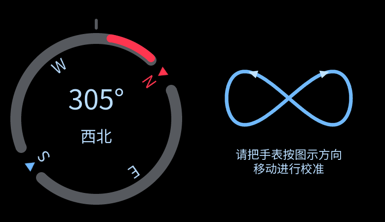

# 指南针

## 2026-10-24 UI 小闭环

用户从前轮地磁接入前检查接续，要求直接制作指南针 UI；三张照片分别提供主页面、可选校准提示与应用图标参考。随后明确圆环底色应偏灰，覆盖初版蓝色环。按既定“硬件跑通→页面→功能”顺序，本轮只交付页面和显示绑定，测量、校准判定及服务生命周期另轮接入。[原始测量证据](MMC5603.md#compass-readiness-20261024)支持有界相对响应，不证明绝对北向或倾斜精度。

### 外观与显示输入

- 390×450 黑底，无新增标题栏或按钮。灰色双弧环 `0x56595e`，保留红色北向弧段、N 与指针；中心为角度、下方中文八方位，顶部短标记固定。环与方位随已提供的航向旋转，整数 0–359° 有效，0° 是真实北向显示输入，非法值回未知。
- 校准显示复用 `compass_calibration.xml`：水平“8”字方向图、两行提示“请把手表按图示方向／移动进行校准”。`screen_compass_calibration.xml` 只用于官方编辑器直接检查同一组件；运行时在主屏内切换，不新建导航或自动结束流程。
- `compass_view.c/h` 接受 UI 线程上的独立显示副本：未知、有航向、校准中。它不读取传感器，不判定数据年龄／校准完成，不做磁场换算或倾斜补偿，不新增线程、定时器、Flash、PM 或传感器命令。
- Product 菜单列表／三列新增稳定 `compass` 身份，深蓝底红白针原创图标；页面可打开但没有数据提供者，显示 `--°`、`--` 和“等待数据”，隐藏北向／方位标记并使用暗灰环。`READY` 只表示页面可用，不代表方向有效。普通返回、KEY1、短睡与离页回收沿用 shell。
- 官方 XML 与独立 UI Demo 的 `305°／西北` 是视觉样例；Product 初始化显式使用未知状态，不包含演示测量提供者或伪造注入命令。校准显示目前可由测试输入切换，Product 不提供没有后端的校准按钮。

### 源与生成边界

XML 拥有布局、样式、具名控件与资源，`compass_view` 只绑定显示输入与动态角度；C 由官方 LVGL Pro GUI 导出。`Generate-Compass-Assets.py` 只生成独立指针／图标／校准手势 PNG，不生成 XML 或 C，不将整页截图作为实现。固定字体裁剪清单加入新中文；`compass_32` 单独注册八方位字形。菜单描述符可选引用官方图片资源，原有应用继续使用原图标字体。

### 验证与边界

活动结果与下一步只见 [STATUS 当前区](STATUS.md#current)。[精简证据](evidence/2026-10-24/compass-ui.json)绑定最终源码、命令、日志与失败：XML 格式、官方 Editor 2.0.1／预览 LVGL 9.4.0 校验导出及主屏／校准页 100% 预览通过。实际 LVGL 的字形、正交及359°／方位分界、非法360°／NULL、未知／校准切换和指针安全区通过；真实指针验证列表／三列点击、左边缘返回、KEY回主页及重开未知。相关 Debug 4/4（3.33秒）、保留断言 Release 4/4（1.32秒），独立只读定点复核无剩余确定阻断。

锁定 SDK 下 Product `20261024-225551-200`／BIN `c1fd4048…`（8,272,568B）与 UI Demo `20261024-225803-337`／`b68ca51e…`（8,005,360B）均官方 SCons 编译成功；563／504 份源码及29／22产物逐字节重哈希一致，官方新生成清单／实际来源和链接map符号已核。独立指针、图标与校准PNG解码像素合计210,304B；Product相对旧采样版BIN增242,560B，未新增后台活动。旧29／22产物先ZIP保全并核验，原始日志及截图在主目录忽略的 `artifacts/compass-ui-20261024/`。初次资源重名、主机类型／访问器错误及旧测试数量／仅字体假设均保留失败记录，最终验证对应修正后版本。

实机未操作，不沿用前轮旧 BIN 的硬件结果证明新页面显示、触摸、方向准确度或功耗。板上仍为 `2438dc7c…`，本轮没有新串口或下载授权。

## 2026-10-24 未校准数据接入

本节覆盖前轮“无提供者”的实现边界。用户明确要求接入并烧录，随后决定暂缓八字校准。本轮不开放校准按钮或自动结束校准；安装零点／轴向标定、软硬铁校准及倾斜补偿均待完成。原有8字图仍为未启用的显示组件。

器件原生能力、资料及既有测量证据见[地磁契约](MMC5603.md)。继续使用原生encoded自检／Auto_SR单次测量，未替换片上算法或改SDK。软件只把中心化XY投影为`atan2(X,Y)`的0–359°；符号依据前轮顺时针相对响应，零点及磁北未标定，绝不能将角度或中文北向解释为已验绝对方位。

`product_imu_diag`复用唯一传感器worker与同一个`mag`实例，前台约200ms触发间隔（另含转换及共享事务开销），无独立线程、timer、IRQ或Flash保存。`product_compass.h`只提交可见资格／复制同步缓存；main在LVGL输入前后协调，OFF及面板诊断前停用。指南针实际前台含DIM才采样，离页、充电、提醒、通知覆盖及长续航暂停；恢复可见后开始新代次并重新原生自检，不复用旧航向。数据满1000ms、饱和、零XY、自检／I/O失败均无效，页面回`--°`；新提示“未校准，请保持水平”经XML及官方生成物持有。

取消立即屏蔽旧代次缓存，worker完成本地停止确认。故障锁存在当前可见会话，反复UI同步不重启；离开重入可重试已经清理的故障。停止失败保留owned／IDLE责任，页面变更不重试清理，只接受已有显式`wf_mag stop`／日常恢复路径。只读`wf_compass status`输出请求／活动／有效／故障／清理、代次／session／序号／时间、原始XYZ／航向、自检与停止缓存，不做I2C或提供伪造注入。

软件与同BIN设备验证分别记录于[STATUS当前区](STATUS.md#current)。本轮原始记录在主目录忽略的`artifacts/compass-live-data-20261024/`；未取得新设备结果前，不沿用旧测量BIN证明本页面的真实数据、生命周期或功耗。

[软件证据](evidence/2026-10-24/compass-live-data.json)绑定最终源码／产物：Debug全量66/66，新增UI／worker最终2/2；Release相关8/8，最后仅停止日志改动的worker两配置各1/1。覆盖XY投影、代次／过期、准备中取消、自检／清理失败及显式恢复、光感／腕共存，以及实际LVGL新字形／提示边界、旧数据隐藏、提醒暂停、OFF／KEY恢复和返回。官方Editor2.0.1／LVGL9.4.0导出成功，新增`compass_notice`已在生成C，100%预览及实际渲染核查通过。Product`20261024-235713-265`／BIN`3b78180c…`（8,276,644B）、Demo`20261024-235138-151`／`98cded93…`（8,005,648B）编译退出0，566／506源码与29／22产物字节核验一致；未新增线程，worker6KiB／main16KiB不变，新栈峰值和电流未测。旧产物先ZIP保全。不存在的主机target、重复状态命令和未启用显示策略的测试夹具失败均保留并修正重跑。

## 2026-10-25 同BIN有界验收

软件PR #152合入`840a7d5`后，用户重新确认设备条件并授权继续；复用精确Product`3b78180c…`，无源码修改或重编。566源码（4仅Git换行）／29产物、SDK锁／端点／DryRun／retained钩子核对后，三镜像write＋verify成功，RTC从2000校回真实UTC并读回；计步总0／小时mask3fff／检查点130、腕和自动亮度已保存开启恢复。用户确认显示、触摸、KEY1和时间正常。原始资料和精确操作见[设备证据](evidence/2026-10-25/compass-live-hardware.json)。

本次复用既有Console／Journal，专用只读观察适配仅允许缓存status及show_date，不启动地磁、控制PM／charger、复位或校时；模拟5/5和取消路径先验。首个准备确认5分钟超时、尚未开端口；用户要求重开后，13:32:42–13:34:43新窗口中人工确认四项动作／末态，程序保存原始UART并正常关口。流程passed只代表交互完成，以下结论另经原始字节／同步缓存核验。

120条完整缓存中51有效，session1–5序号／时间推进，原生encoded自检PASS／有效未饱和XYZ／errors0。359→23→18及19→353等显示角变化支持相对响应；不证明转动准确90°或绝对磁北。完整stop1／2均stopped1／owned0／errors0，随后session2／3重开；离页按钮确认时已经重开session3，不能将其后快照写作停止。session3的end2是取消，owned0／stopped1／errors0及后续generation6／fault0／cleanup0不支持持续硬件故障判断。

明确display sleeping并进入原AOD后stop4／gen8确认停止，KEY1恢复产生session5及新valid1／selftest1；后续另一次息屏／腕唤醒单列，不算第二次受控KEY检查。末尾stop12输出与状态行交错，保留原始字节、不补行；后续完整cache与mag响应确认请求／活动／有效／故障／cleanup均0，session6 phase2／end2／owned0／stopped1／after10／errors0。自动亮度最终enabled1／active1／valid1／fault0／cleanup0、腕服务开启、计步检查点保留。PM allow1、own_idle1来自其余运行责任，不能声称整机零占用或物理DEEP。

本轮支持新BIN数据更新、相对转向、离页停止／重开和一次短息屏KEY恢复及末态正常。未验磁北／安装零点、软硬铁／八字校准、倾斜补偿、非零计步保留、电流、续航或物理深睡；保留既定待完成项，不为此自动扩展实验。

## 2026-10-25 校准前置调查（按用户决定后置）

在`1c64ff6`核到锁定SDK的`mmc36x0kj/MemsicAlgo.lib`原厂署名候选：输入为g／Gauss，提供自动校准、可靠度、偏置／场强保存及已校准磁场，另有依赖加速度的姿态接口。九项软铁矩阵是初始化输入，当前没有证据证明库会自动估计该矩阵；目录名、通用接口及Cortex-M33属性都不能直接证明适配本板MMC5603。继续保留片上Auto_SR和原生自检；[原厂手册](https://www.memsic.com/Public/Uploads/uploadfile/files/20220119/MMC5603NJDatasheetRev.B.pdf)将高级校准／倾斜补偿另列为软件算法，不能将芯片自检PASS等同用户校准。

独立链接探针使用现有Arm GCC14.2.1、M33硬浮点及短enum／wchar。原库直接链接缺`__hardfp_*`数学符号；本地实验适配后仅链接成功，探针text25,318B／data432B／bss1,308B。它不是Product体积增量、算法执行或设备证据，未改SDK／固件，未证明库适用范围、数值行为或单独许可。原始源／命令产物在本地主目录忽略的`artifacts/compass-calibration-preflight-20261025/`；合成输入仿真探针已准备但未执行。用户此时要求先验已完成的①②③，本调查在此停止；恢复时先核候选运行与真实acc／mag轴向及配对，不借此启动设备校准。活动项回STATUS。
