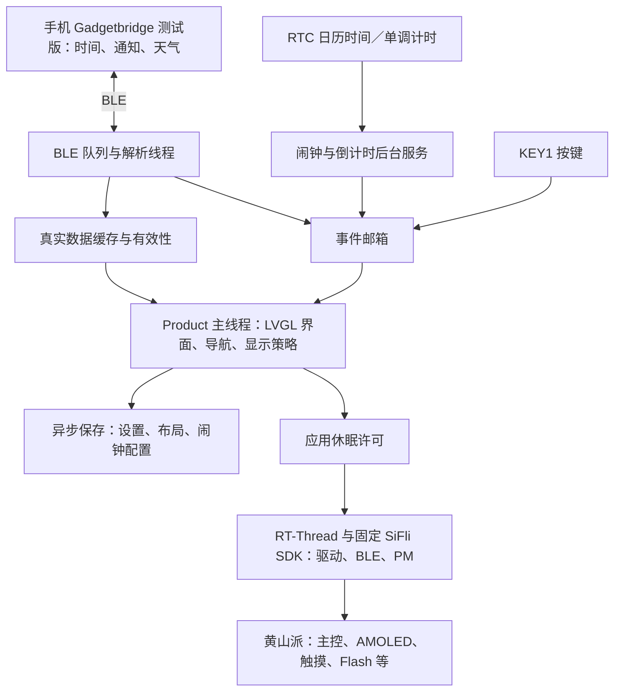

# Product PM／事件唤醒实验 P1

<a id="current-power-system"></a>
## 2026-10-14 当前系统与低功耗说明

10-15 状态梳理：下文机制核验与旧设备结果保留原版本；最近已确认 BIN `0794fb9d…` 还有仅电池页面／KEY1 及短时双电源禁充回读，见[同接记录](CHARGER-PREFLIGHT.md)。用户当前确认电池连接，屏幕 `USB` 仍是缺失数据占位。没有新增长时、驻留、电流或续航测量。无任务轮询／退出清理等软件改进可以独立推进，其省电收益在具备仪器后另验；完整 H2／功耗基线不作为普通功能开发的统一前置，分层方法见[验收说明](ACCEPTANCE.md#validation-20261015)，当前任务仍只见 STATUS。

本节 PM 机制说明沿用 `e194d06` 的源码核验；后续 PR #59 的 PSRAM 修复已合入 `e31c8c5`，本轮该基线上的默认禁充镜像 `3c2985b4…` 已构建／write／verify，并取得 USB 启动回读及仅电池页面／KEY1 有界反馈，完整版本见[充电前置](CHARGER-PREFLIGHT.md)。没有测流。后续历史 P1 的“默认 hold”“BLE 永久等待”不能覆盖本节。用户已决定延期正式功耗测量，前序 [粗测操作单](ACCEPTANCE.md#first-power-session) 留作历史方法；活动项只见 STATUS。

**成熟度说明：目前完成的是基础休眠／恢复接入，整机低功耗优化与实测闭环尚未完成。** 停 UI、关显示和释放阻睡请求已有实现；100ms 无任务轮询、所有外围供电／时钟／引脚、BLE 实际参数及唤醒来源尚未完成系统性优化。BLE 保持连接所需的无线活动是必要负载，优化目标是满足体验下减少其占空比；不能把所有唤醒一概视为无效，也不能由 Deep 计数宣称达标。

### 系统怎样工作



这张图是职责和数据流，不是完整线程清单。`apps/product` 是实际产品，`ui_demo` 是固定数据演示，`bringup` 是诊断目标。板载 RTC 提供日历时间，手机可校时；倒计时使用持续时间／截止状态。FlashDB 保存设置、布局和闹钟配置；通知历史当前在 RAM，不能承诺重启保留。界面有真实通知归组与最多十条消息历史、天气／AQI、秒表、倒计时、闹钟和呼吸引导；具体设备结果按各专题版本记录。心率／血氧等未接入能力仍表示不可用；画出了卡片不等于存在传感器数据。`USB` 是开发条件标记，不是电源自动识别或电池百分比。

### 已经实现的基础休眠机制

| 机制 | 实际行为与来源 |
|---|---|
| 自动变暗、息屏 | [display_policy.c](../core/display_policy.c) 按设置推进显示状态；手电筒、临时常亮及呼吸训练等亮屏申请有独立条件。测量要记下这些状态 |
| 息屏停止 UI 定时处理 | [main.c](../apps/product/src/main.c) 的 `screen_off()` 停 LVGL timers，等 LCD 空闲，关闭触摸／显示，主线程阻塞等待事件；不是继续每 20ms 刷一遍黑画面 |
| 自动放开深睡限制 | [product_pm.c](../apps/product/src/product_pm.c) 为 `allowed = true`；`hold = !allowed || !display_off`。亮屏及恢复首帧期间持有 idle 请求，屏灭才释放应用自己的请求；其他驱动仍可阻止深睡 |
| KEY1 与事件恢复 | KEY1 配为 AON 唤醒；手机后台事件、闹钟、倒计时可唤醒处理。事件发生不必亮屏：是否预览由通知／勿扰／当前会话决定。需亮屏时先持锁、恢复显示触摸、画完首帧再提亮 |
| 后台计时不依赖画面刷新 | [product_countdown.c](../apps/product/src/product_countdown.c) 与 [product_alarm.c](../apps/product/src/product_alarm.c) 使用独立 RT 软 timer 和权威状态；息屏仍可到期，再投递事件给 UI |
| 减少无意义重画 | 亮屏主循环仍有 1–20ms 事件等待、250ms 数据检查，但时间等字段未变化时不因此重画静态页；息屏不走这个亮屏循环 |
| 可做 PM 对照 | `wf_pm hold` 暂时阻止应用放行深睡，`wf_pm allow` 恢复；`status`／一次性 `sample` 只提供诊断。它们不是电流表 |

Product 的 [proj.conf](../apps/product/project/proj.conf) 开启 `BSP_USING_PM`、`PM_DEEP_ENABLE` 和 BLE。这里的 Deep 是 SDK 的模式名称：许可打开、软件路径执行、实际驻留、低电流，是不同层次的证据。

KEY1 有效输入还受板级供电条件影响：官方设计按钮 SW1 接 PA34 与 VBAT。本轮无电池 USB-only、CEB=1 时 KEY1 无响应；禁止 DEEP 后也复现，串口及软件唤醒正常。用户切换为仅电池后，页面和两次自然息屏 KEY1 正常。实物节点电压未测，不能把该条件描述为 PM 全部失效或充电通过；具体限制见充电前置。

### 仍然会唤醒或耗电的部分

- **保存线程每 100ms 检查一次**：[product_services.c](../apps/product/src/product_services.c) 的 `storage_thread()` 仍有 `rt_thread_mdelay(100)`；检查不等于每次写 Flash，但会周期唤醒。改成有变更才通知、按保存／重试截止等待是明确的优化候选；正确性可独立验证，降低多少电流须后续同条件测量，不以缺仪表为由声称它已合理。
- **BLE 保持连接仍要收发无线包**：Product worker 等消息队列，等候上限由天气请求剩余时间或三小时检查期限决定（[product_ble.c](../apps/product/src/product_ble.c)）；这不等于无线电每三小时才活动。断连时也可能继续广播，应把状态记为“未连接／广播”，不能写“蓝牙关闭”。
- **后台日程仍有定时检查**：运行中的倒计时按最长五分钟分段；闹钟调度即使没有有效到期项也有最长五分钟等待（[alarm_schedule.c](../core/alarm_schedule.c)）。这些是软件等待上限，不是整板连续睡眠时长。
- **板级电源有额外负载与联动**：USB 转串口、供电转换及板载器件可能耗电；锁定 SDK 的 LCD 上／下电还操作 3.3V、传感器相关供电和音频 PA。没有测量前不能断言这些器件已全部进入最低电流状态。
- **未完成整机省电收尾**：没有 MAX30102 采样／LED 关断服务，没有已接入的电机提醒，没有电池充电安全闭环和电量标定；抬腕 C2 未合入本主线，单击触摸唤醒未开放。不能因为没有使用 IMU 就断言其芯片物理断电；BLE 参数、全部驱动约束及常驻负载还未逐项做功耗优化。

### 哪些已经在板上验证，哪些没有

历史 P1 的 USB 实验确认过 PM allow／hold 对软件计数的影响、息屏接收通知、KEY1 多轮恢复；后续通知／倒计时／闹钟／呼吸专题各有其版本的有界 USB 结果，本轮禁充镜像取得仅电池页面与两次自然息屏／KEY1 用户反馈。**尚无电流、脉冲能量、精确深睡驻留、整套当前版本长测或电池续航数据**。PM enter／exit／deep_ticks 含 SDK 准备和恢复路径，不能换算成微安或睡眠占空比。

正式测量恢复时需能记录电流随时间、睡眠小电流与唤醒／电机峰值，并同时掌握供电电压、测量压降、采样条件和事件标记；采用固定夹具与可重复运行的场景，测量窗口避免依赖临时串口操作。先自动运行还是事先设定后断开调试链路，由仪器和供电方式确定；不在本轮采购或预设型号。需要回答的仍是亮屏／息屏差额、allow／hold 对照、事件能量和退出后恢复。USB 分轨用于定位，电池端测量用于整机能量预算；自制 PCB 仍需供电、PPG 原始信号、驱动与尺寸证据。

## 2026-10-10 倒计时截止与事件

下方 P1 为 2026-09 历史版本；现版 PM 启动默认允许息屏自动深睡，亮屏 / 首帧恢复仍持有应用 idle 请求，配置与实现以 `product_pm.c` 为准。本轮新增 `WF_EVENT_COUNTDOWN`，邮箱接收掩码同步纳入；事件只提示主线程读取权威服务状态，不传递“这个位出现几次”的任务计数。

独立一次性软 timer 在线程上下文推进倒计时，与 LVGL handler 无关；长任务按安全的最长 5 分钟等待段重算，SDK / 时钟证据、旧 callback 竞争与 getter 不推进状态的验证见 [COUNTDOWN 第二轮](COUNTDOWN.md#round2)。屏幕关闭期间，新待交付到期事件经覆盖宿主准备暗屏首帧并唤醒；30 秒后的已交付提醒保留，旧事件不重复唤醒，KEY1 再次展示。没有新硬件操作，真实 LPTIM / Deep 唤醒、计时误差、压力和电流仍须同版设备验证；已知存储 100ms worker 本轮保留，不能把等待段直接等同于整板连续休眠时长。

2026-09-27。用户确认第二批采购全部下单，并继续昨天的 A → P → B 顺序。A1 已取得真实手机链路；本轮只在同一 Product 核验 PM 和事件恢复，完整通知 UI 随后接入。沿用 PR #24 中 P 首轮最多 4h 的有界定位范围，USB 供电，未接电池，无电流或续航结论。

## 实现与可回退边界

- 工作树复用 `C:/Users/13984/.codex/worktrees/ble-first-link/wristflow`，新分支 `codex/product-pm-wake` 基于 BLE 记录 `8df22c3`；原目录用户改动保留。SDK 及子模块仍锁定，源码零修改。
- Product 开启 `BSP_USING_PM` 与 `PM_DEEP_ENABLE`，保留 BLE；不开启 Standby、触摸唤醒、GUI_APP_PM 或高频 PM_DEBUG 输出。锁定 SDK 的 HCPU Deep 策略门限为 30ms。
- 新增 `product_pm.c/.h` 统一 KEY1、手机事件及一次性采样事件。启动默认禁止深睡；亮屏和恢复首帧期间持有应用的 `PM_SLEEP_MODE_IDLE` 请求。`wf_pm allow` 只在屏幕已关闭时放开该请求，`wf_pm hold` 可撤回，重启再次默认禁止。其他 SDK 驱动自己的请求保持原样。
- KEY1 配置 PA34 对应的 AON 双边沿唤醒。手机事件由 BLE worker 完成解析，再通知主线程；息屏主线程处理后台事件后继续等待，不因此亮屏或导航。通知 UI 的预览／浮窗／勿扰将在 B 增量接入，不在 P1 中伪造。
- LCD 关闭前等待 busy 清除，关闭 API 为同步；触摸关闭为异步，但驱动持有自身 idle 请求并在 deinit 时删除 FT6146 100ms timer。唤醒恢复显示前应用重新持锁，仍等待首帧完成才提亮。
- `wf_store` 无工作时每 100ms 醒一次，本轮先保留这项已知睡眠扰动条件，不同时改持久化协议。BLE worker 阻塞等待消息队列。单次测量不能代表连续长睡或长期稳定性。

```text
wf_pm status
wf_pm allow
wf_pm hold
wf_pm sample
wf_pm wake
wf_ble status
```

`allow` 自动安排 5 秒后的一次采样，`sample` 也只安排一次；没有常驻采样线程。`wake` 是诊断唤醒，必须与真实 KEY1 的证据分开。串口本身可能扰动运行，原始日志只留本机忽略目录。P1 初版放开 PM 后，串口 `sample/status` 命令曾未收到响应；未启用 UART AON 唤醒，不保证深睡时输入串口能被接收。诊断先按 KEY1 让界面亮屏、应用持锁，再执行命令；不要把串口不响应直接当作 BLE 失联或复位。

## 证据含义

`rt_pm_notify_set` 在关中断上下文中仅更新计数，线程上下文才打印。`enter/exit` 记录尝试和返回；`deep_elapsed/deep_ticks/max_ticks` 记录 SDK Deep 路径返回后的补偿 tick，可能包含驱动 suspend、WFI 前后准备与恢复耗时。待处理中断导致 WFI 立即返回也可能出现正 tick，因此这些值不等于精确硬件驻留时间或功耗。结合 SDK 路径、唤醒源和事件功能验证描述软件休眠路径，硬件功耗另测。

独立审查未发现确定的应用 idle 请求泄漏或同批 PHONE/KEY 丢键；不覆盖真实线程压力、驱动异步时序或 WFI 驻留。主机测试直接编译实际 PM 适配器，使用 RTOS/PM mock 核对重复 allow/hold、十轮开关屏请求配对、混合事件、tick 回绕及回调无 I/O。

## 构建与当前验证

主机配置、Ninja 构建和 CTest 退出 0，14/14 通过；记录 `artifacts/ble-validation/pm-host-result.json`，日志 `pm-host.txt`，产物 `artifacts/host-pm/`。Product 命令仍为 `pwsh -NoProfile -ExecutionPolicy Bypass -File artifacts/build-isolated.ps1 -Example product`，底层官方 `scons --board=sf32lb52-lchspi-ulp -j6`；构建不烧录。

首版 Product 构建记录 `artifacts/product/20260927-155232-915/result.json`：退出 0、产物校验通过，266 个工程源哈希一致。首版主 BIN 3571600 B，SHA-256 `ae000f347bfae6f5f43889be92b9e4700fc92207c51dd968599450bc77ffd7d0`。上板发现诊断行超出 SDK `RT_CONSOLEBUF_SIZE=128`，尾部截断；现拆成短行，并在主机测试用最大 uint32 计数验证每次打印长度小于 128 字节。

修正版主机 14/14 再次通过，日志 `artifacts/ble-validation/pm-host-final.txt`。最终构建 `artifacts/product/20260927-161624-537/result.json` 退出 0、校验通过、266 个源哈希一致。main.bin 3571648 B，SHA-256 `60d2ad2d050ff19c909af307bdd10406f6c5a4eb0172ba27870ca770e9dc72e4`；bootloader 58496 B，`e59d70db44367d524fbb46a8a014ce0092462e86959d101a8e2e00ad27bb5e21`；ftab 11288 B，`7aa8fe564a0adf3025c718f28319a64d7b1e933cc9e5a5365e7fe5fc5c22bec0`。版本沿用 Python 3.13.15、SCons 4.10.1、Arm GCC 14.2.1。SDK 既有告警未抑制。

## 初版硬件发现（日志修正前）

COM5 CH340 的三镜像烧录/verify 退出 0，作业 `j-uqql98`；地址仍为 ftab `0x12000000`、bootloader `0x12010000`、main `0x12020000`，未写设置区或整片擦除。串口作业 `j-hb2djo` 从 16:10:49 至 16:17:55，正常关闭退出 0；一次受控 RTS 复位 150ms，1Mbps 8N1。启动恢复原有三页布局、亮度 47，手机自动连接／订阅、MTU=131、校时 result=0。

用户确认默认禁止深睡时显示／触摸正常，并关闭手机蓝牙。16:13:31 未连接、屏幕关闭时 hold 状态 enter/exit=0；`allow` 后 own_idle/sdk_idle=0，5 秒采样 enter/exit=54、deep_elapsed=49、deep_ticks=4997、max_ticks=104。尾部 wake 字段被日志缓冲截断，不能补猜。16:15:39 KEY1 唤醒，先重新持锁、随后完成首帧并亮屏；用户确认显示／触摸正常，再恢复蓝牙。重新连接 MTU=131、校时 result=0。后续串口 sample/status 无响应，SDK Deep 路径内 UART 行为按上方限制处理。

这些未连接结果仅对应首版；修正版对应结果如下。日志修正未改变 PM 决策，但不把旧记录自动当作新固件全部验收。

## 修正版硬件结果

最终三镜像写入／verify 作业 `j-2bs3v5` 退出 0，地址与首版相同。串口作业 `j-y5nyta` 于 16:20:33 打开 COM5，受控 RTS 复位 150ms；16:20:50 手机自动连接、MTU=131、RTC 校时 UTC=1790497249/result=0，重新订阅成功。

- **已连接、息屏对照**：16:21:22 hold 状态 enter/exit=0、own_idle/sdk_idle=1、off=1。放开后 5 秒采样 enter/exit=67、deep_elapsed=48、deep_ticks=4956、max_ticks=118、wake=0x4，own_idle/sdk_idle=0，屏幕仍关闭。
- **息屏事件**：16:22:20 和 16:22:38 接收 QQ ID `1790491718/1790491719`；用户确认手机通知到达、板屏仍黑。主动 list 的原始字节均包含指定文本 `PM中文测试456`，公开只保存该测试标记，不保存标题或正文的其他部分。恢复前 phone_off/background 由 2 增至 4，中间没有 screen-on 日志。该计数还包括初始校时／查询，不能全算作通知条数。
- **KEY1 与界面**：用户明确确认五轮自然熄屏／KEY1 唤醒及触摸正常；串口实际记录七轮 allow=1 下的 KEY1 恢复，均有先 own_idle=1、后 screen-on 的顺序。恢复样本 wake=0x40002/0x40006，其中 PIN10 位为 `0x40000`，与板端 KEY1 AON index=10 对应；5 秒采样的 `0x4` 为 LPTIM1。位定义来自 SDK `drivers/cmsis/sf32lb52x/hpsys_aon.h:285–329`。不把这些样本扩大为长期压力验收。
- **撤回**：16:24:40 已执行 hold；用户随后又按 KEY1 配合确认重复 hold 无副作用。16:27:09 再次息屏、allow=0、own_idle/sdk_idle=1，enter/exit 仍为 1947、deep_elapsed 仍为 1261，与撤回时相同，证明运行时门锁阻止后续 Deep 尝试。最终 BLE connected/subscribed=1，messages=2、added=2、updated=0、removed=0、rejected=0、unknown=0、dropped=0。

最后保留运行时 hold 状态，手机连接不主动断开，串口助手通过 stop 文件正常退出并关闭 COM5。本轮通过的是 USB 下 SDK 休眠路径、息屏后台事件和 KEY1 恢复；没有证明精确硬件驻留、休眠电流、电池续航、触摸唤醒或 30–60 分钟联合压力。已知 100ms 保存线程轮询后续可按数据优化。

脱敏硬件摘录和源码／镜像清单见 [pm-p1-hardware.txt](evidence/2026-09-27/pm-p1-hardware.txt) 与 [pm-p1.json](evidence/2026-09-27/pm-p1.json)。下一增量按已确认契约接完整通知中心、详情、亮屏浮窗、息屏预览和勿扰；底层保留后台处理与点亮屏幕的区分，继续使用可回退 PM gate。P 首轮在 4h 时间盒内完成，未扩展传感器负载或无界调功耗。
