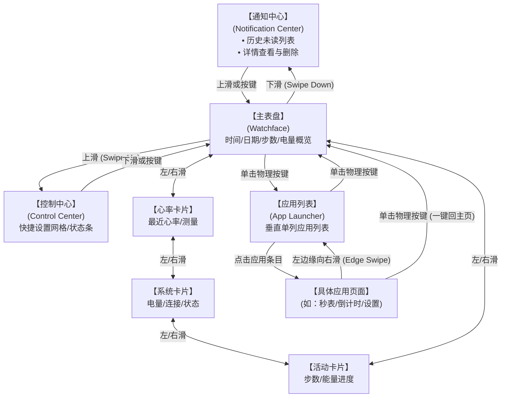
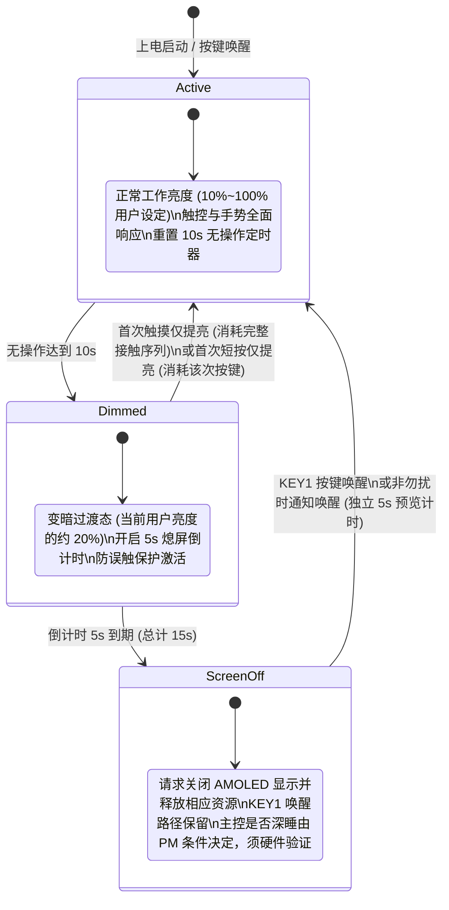
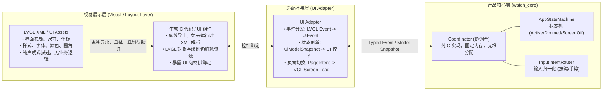

# WristFlow 交互规格与状态机契约

更新日期：2026-10-16。硬件已到货；正文保留早期交互契约，最新覆盖规则见下文。
本文件定义 WristFlow 智能手表的全局交互拓扑、手势与按键映射、亮灭屏电源状态机、核心页面规范、LVGL XML 视觉解耦架构契约，以及 Redmi Watch 4 实拍参考索引。

本文件描述产品契约，不代表实现或硬件已通过。2026-09-22 复核将变暗亮度、息屏与深睡、返回与回主页的表述按既有共识统一；工具链许可、XML 审核及待确认项见 [LVGL Pro 说明](LVGL-PRO.md)，产品用语见 [术语表](../CONTEXT.md)。

**2026-09-26 覆盖规则**：[产品应用与组件编辑共识](PRODUCT-UI-SCOPE.md) 及 [设置与显示状态](PRODUCT-SETTINGS.md) 记录最新确认，冲突处以这两文为准。组件页为可编辑的 1–6 页（默认 3），已有槽位替换自动保存、新页填满点勾提交、删除仅一次确认；编辑中禁止左右切页。应用布局为列表/三列，不是组件编辑入口。表盘选择移入设置并保留长按；默认总熄屏 10 秒，最后 5 秒变暗；5 秒选项为 4 秒正常加 1 秒变暗。手电筒保持全亮，编辑现场与新页草稿豁免长睡回表盘；持续亮屏固定倒计时、到期恢复普通超时。单击亮屏须先验证低功耗触摸中断唤醒，本轮隐藏，不做保持轮询版本。AOD/系统操作、休眠功耗与长测后置。下文早期 15 秒图示仅作历史记录；未被覆盖的防误触/返回契约继续沿用，实现状态见 STATUS。

秒表退出规则再覆盖早期“后台运行”描述：运行或有非零数据时，请求离开秒表先弹确认；取消继续留在秒表，确认停止并清零。前台熄屏不算退出，唤醒后继续显示秒表。普通页熄屏满两分钟后，唤醒必须先在黑屏中回表盘并完成首帧，再提亮。

**2026-10-10 倒计时覆盖规则**：用户最新五张实拍及 Q2–Q7 已确定单任务、1/2/3/5/10/30 分钟快捷预设、时分秒滚轮、立即取消、暂停 / 继续、离页保留与表盘沙漏单击回跳、到期关闭 / 按原时长重来。详见 [倒计时契约与分轮证据](COUNTDOWN.md)及 [BASELINE](BASELINE.md#2026-10-10-恢复常规开发与倒计时)。第一轮为演示 / 主机 UI 与独立模型；[第二轮](COUNTDOWN.md#round2)接 Product 服务与独立截止、30 秒待处理提醒、勿扰及有效会话 / 确认恢复。源码、主机、编译和第三轮 USB 真机分开记录，当前没有倒计时硬件通过结论。

**2026-10-11 闹钟覆盖规则**：最多五条、初始为空；24 小时时分、仅一次 / 自选星期 / 每天 / 工作日（周一至五）/ 周末（周六、日）。新增默认启用，编辑保留启停；子页勾只确认草稿，设置页勾最终提交，返回取消当前未提交修改；删除仅一次确认。KEY1 离页丢弃草稿，已提交配置在 Demo 会话保留；编辑现场豁免长睡回表盘，列表仍按普通页规则。首版提醒只关闭，贪睡、智能唤醒及法定节假日 / 调休后置。详见 [闹钟契约](ALARM.md)，分三轮完成，第一轮无 Product 调度、保存或硬件验收。

**2026-10-16声音与振动规则，10-17设置实现**：[第5节](#sound-vibration-policy)区分产品决定、应用候选与当前设置能力。静音、勿扰、振动模式和硬件能力分别表达；旧固定图样与“当前没有电机”不能作为当前事实。声音提醒、音乐播放是最终目标，当前仍未接入；首轮只实现振动三档、保存和显式改选体验。

---

## 1. 物理平台与输入输出边界

- **主控平台**：立创·黄山派 SF32LB52-ULP（SF32LB525UC6，8MB PSRAM + 16MB NOR Flash，SDK 板名 `sf32lb52-lchspi-ulp`）。
- **显示屏**：1.85 英寸 AMOLED，分辨率 **390 × 450**（16-bit RGB565，CO5300 驱动，SPI/QSPI 接口）。
- **触控输入**：FT6146 电容式多点触摸芯片（当前按单指手势驱动，首版触摸唤醒关闭，以按键唤醒为主）。
- **物理输入**：单实体按键 **KEY1**（PA34，高电平有效，带防抖与 AON Pin Wakeup 支持）。
- **触觉反馈**：VIB已接用户两线1027电机，Product PA20／LDO3手动单次20／100ms启停有界确认；自动场景及电气匹配仍未验收，见[电机契约](MOTOR-PULSE.md#supply-prepare)。
- **功耗基准模型**：每日 45 分钟亮屏交互 + 30 次通知（5 次打开处理）+ 24h BLE 逻辑连接 + 心率间歇采样（目标 7 天续航路线）。

---

## 2. 全局手势导航拓扑（Redmi Watch 4 对标）

导航模型严格参照 **Redmi Watch 4** 的交互逻辑：以主表盘为原点，四向手势对应四大快捷入口，单实体按键负责应用列表展开与主页返回。

### 全局手势与按键映射表

| 场景 / 界面 | 手势 / 输入事件 | 动作与目标页面 | 动画与交互特征 |
|---|---|---|---|
| **主表盘** | 下滑 (Swipe Down) | 进入【通知中心】 | 页面从顶部顺滑下落展开 |
| **主表盘** | 上滑 (Swipe Up) | 进入【控制中心 / 快捷设置】 | 页面从底部向上滑出 |
| **主表盘** | 左右滑 (Swipe Left / Right) | 切换【核心卡片 (Tiles)】 | 无限环形滚动，支持弹性阻尼与未过半取消回弹 |
| **主表盘** | 单击实体按键 KEY1 | 进入【应用列表 (Launcher)】 | 垂直列表平滑载入，恢复上次离开时的 offset |
| **主表盘** | 长按实体按键 KEY1 (3s) | 弹出【电源选项菜单】 | 重启、关机、进入长续航模式 |
| **核心卡片** | 左右滑动 | 切换相邻卡片或回表盘 | 横向连续切换 |
| **核心卡片** | 单击实体按键 KEY1 | 直接返回【主表盘】 | 快速一键回主界面 |
| **二级页面 / 应用内** | 屏幕左边缘向右划 (0~40px) | 返回上一级 (Back) | 边缘手势切页；若需跟手感，板上评估实时平移与 1/3 阈值取消吸附 |
| **二级页面 / 应用内** | 单击实体按键 KEY1 | 直接返回【主表盘】 (Home) | 放弃当前所有深层栈，一键回主界面 |
| **普通亮屏界面** | 无操作超时 (默认 10s) | 进入【变暗过渡态 (Dimmed)】 | 屏幕平滑降到当前用户亮度的约 20%，不改写保存值；临时常亮等独立模式另按其规则处理 |
| **变暗过渡态** | 再次超时 (默认 5s，总计 15s) | 进入【息屏态 (Screen-Off)】 | 请求关闭 AMOLED 显示，按驱动能力释放资源；实际深睡另验 |
| **变暗过渡态** | 任意触摸事件 | 恢复正常亮度，**吞掉点击** | 仅提亮并重置计时器，防误触底层控件 |
| **变暗过渡态** | 首次短按 KEY1 | 恢复正常亮度，**消耗该次按键** | 保持当前页面，下一次短按才执行该页面的导航 |
| **息屏态** | 单击实体按键 KEY1 | 唤醒屏幕 (Wake Up) | 短暂息屏恢复原页面；长息屏 (>=2min) 回主表盘，计时应用豁免见第 4 节 |

---

## 3. 核心页面详细规格

### 3.1 核心卡片环（Tiles Ring）

首版配置 **3 张功能卡片 + 1 个主表盘**，组成无限环形循环：
`[心率卡片]` <-> `[主表盘]` <-> `[今日活动/步数卡片]` <-> `[电量与系统状态卡片]`

#### 3.1.1 固定槽位与布局模板

信息环的视觉层使用三种固定槽位尺寸，内容替换只改变图标、文字、颜色和数据绑定，不改变槽位几何：

| 槽位规格 | 尺寸 | 适用范围 |
|---|---:|---|
| `quarter` | 165×174 px | 四分之一组件 |
| `half` | 342×174 px | 半屏组件，横跨两列 |
| `full` | 342×362 px | 整页组件，横跨 2×2 网格 |

槽位区域固定从 `(24,28)` 开始，列间距为 12 px、行间距为 14 px；因此 `165 + 12 + 165 = 342`，`174 + 14 + 174 = 362`。四种布局模板固定为：

1. 四个 `quarter`；
2. 顶部一个 `half`、底部两个 `quarter`；
3. 顶部两个 `quarter`、底部一个 `half`；
4. 一个 `full`。

不提供两个 `half` 的第五种模板。布局选择页只负责选择模板并生成稳定的 `slot_0`、`slot_1` 等位置；组件选择页按 `quarter`、`half`、`full` 三种规格分别展示，并允许纵向滚动。相同内容可以有不同的视觉变体，但不能跨尺寸替换。

本轮 XML 页面只验证模板、槽位和选择页的视觉复用，尚未接入配置保存或产品导航。长按后在同尺寸范围内替换组件、保存布局以及恢复上次选择，归入后续 `watch_core` 与 UI Adapter 契约。数字分片的呼吸/伸缩效果也延后到硬件到货后，以局部刷新、帧率和功耗实测决定是否启用；本轮使用静态完整小时资源。

- **手感要求**：手指左右拖拽时，卡片跟随移动；手指滑动位移未过屏幕宽度 1/2 且速度较低时松手，自动平滑弹回当前卡片（取消切换）；位移超过 1/2 或轻微快速滑掷（Fling）时顺畅切换至相邻卡片。
- **内容定义**：
  1. **主表盘**：数字时钟（大字体）、日期/星期、步数简报、电量环形条。
  2. **心率卡片**：最新测量心率数值（BPM）、测量时间戳、24h 简要区间条形柱状示意、即时单次“测量”触控按钮。
  3. **今日活动卡片**：步数总量、距离估算、目标圆环进度条（基于黄山派板载 LSM6DS3TR-C IMU 数据）。
  4. **系统状态卡片**：电池电量精确百分比、充放电状态、BLE 逻辑连接状态、设备运行时间。

### 3.2 通知中心与新消息提醒

2026-09-27 B1 实施补充：完整状态与当前验证边界见 [通知 UI](NOTIFICATION-UI.md)。同 ID 更新去重，收到手机协议 `notify-` 才按 ID 移除；QQ 聊天撤回提示不保证包含原消息关联。手表删除/清空只影响本地。亮屏横幅点击进入中心，息屏预览点击进入该条详情；自动提醒不导航、不停止前台秒表、不放弃组件草稿，明确点击才复用退出确认。勿扰仍入库且抑制亮屏和浮窗。预览超时不重置原息屏时间。B1当时没有电机，双短振是后续目标；当前手动电机证据及可配置场景契约见[第5节](#sound-vibration-policy)，尚无自动通知振动验收。B1 用 App 名称标识来源，未接入手机应用图标。
阶段顺序与原始契约见 [下一阶段](NEXT-STAGE.md)，当前实现与分项真机范围以上述 B1 记录为准。

2026-10-13–14 归组覆盖规则：用户已授权首版 QQ 私聊活动通知按有效生命周期 key＋来源包名归组；无法可靠关联的保持独立。列表显示组内最新消息，点击后旧到新展示已接收历史，进入定位最新、向上查更早；左滑垃圾桶删除整组手表历史，容量仍全局十条。正文只覆盖手机实际推送的通知字段，Q8-D 的 QQ 来源仅提供 99 字，不承诺恢复完整聊天文本。手机 `notify-` 仍按原 ID 删除，精确聊天撤回、群聊及清除后重建关联未验证。不以昵称作为身份。下方旧 B1 单条口径仅在独立卡片适用；实施及各级验证见 [通知归组与历史](NOTIFICATION-UI.md#notification-groups)。

- **新通知到来交互（息屏态）**：
  1. 手机端通过 BLE 推送通知包到达固件。
  2. 若【勿扰模式 (DND)】关闭：点亮屏幕并展示独立 **通知预览页**（App 标识、标题、简略正文）。振动还须满足全局模式与场景条件；旧150ms ON／100ms OFF／150ms ON是历史图样，不无条件套用到所有模式，当前方案与验证边界见[第5节](#sound-vibration-policy)。
  3. 启动 **5 秒无操作倒计时**：无操作到期后重新息屏，不由此宣称主控深睡；点击进入通知中心内该条消息的完整详情，不停在列表。沿用上划收起预览并保持亮屏的手势。
  4. 预览是临时展示，不丢弃原编辑草稿、不停止前台秒表；原短睡恢复/长睡回表盘和豁免规则继续生效。只有主动进入消息才按下方退出确认处理，自动展示和超时不算离开原操作。
- **新通知到来交互（亮屏活跃态）**：
  - 屏幕顶部显示简略 **消息浮窗（通知横幅）**，展示 3 秒后收起，不中断当前表盘或应用操作。
  - 点击进入与主表盘下拉相同的消息页面，再查看详情；与息屏预览点击直接进该条详情的入口区分。变暗态仍遵守首次输入只提亮的过滤规则。
- **主动打开消息时的退出确认**：
  - 有未提交组件新页，或秒表运行中/有非零读数时，沿用现有放弃草稿/停止清零确认；确认后才进入上述消息目标。
  - 取消留在原操作页面，通知仍在通知中心；收到通知本身、预览超时和浮窗收起不能触发确认或自动清理原任务。
- **通知中心列表（表盘下滑展开）**：
  - 采用时间倒序垂直流式卡片列表（首版内存环形缓冲区最多保留 10 条）。
  - 单条卡片点击展开查看完整文本（支持多行排版）。
  - 2026-09-27 按用户 Redmi Watch 4 参考图修订：在列表内左滑单条卡片，露出右侧垃圾桶，点击后原位删除；不为删除进入详情页。右滑或点移开的正文收回操作区，同时最多露出一条的垃圾桶；普通点击完整卡片仍进入详情。列表底部提供【清空全部】操作项。
  - 手表删除/清空仅影响本地记录，不向手机发清除请求；手机发送 `notify-` 时同步移除对应 ID。聊天撤回能否精确移除原消息另需手机关联字段，当前不能凭提示文案删除。双向删除留待后续明确功能，离线通知补送不作承诺。
- **勿扰**：
  - BLE 连接存在时继续接收并保存通知，但抑制通知亮屏、振动、消息浮窗与预览；连接状态独立控制。
  - 闹钟和倒计时到期仍提醒，其振动须服从全局振动模式，关闭时不振；未来声音按独立规则处理。翻腕开关独立，勿扰本身不关闭翻腕。睡眠模式后续组合连接、提醒与唤醒策略。

### 3.3 控制中心 / 快捷设置（Control Center）

2026-09-26 覆盖：按真实能力逐步补齐，保留手电筒、持续亮屏、设置与亮度，接入真实勿扰及连接状态并参考 Redmi Watch 4 整理布局；其他快捷项待对应能力验收。控制中心与设置共用状态。电池未接入时显示已确认的 USB 条件，不显示下文示例百分比；持续亮屏按最新固定计时与确认契约，不采用下文早期 15 秒描述。

- **入场与布局**：表盘由下向上滑出；整体布局参数化（预留 3×3 或 2×2 大图标网格，待硬件到货后根据 390×450 实际视野与触控热区最终敲定）。
- **顶部状态栏**：紧凑展示电池电量百分比（如 `85%`）与 BLE 连接小图标。
- **首版 4 大核心开关（2×2 铺满一屏）**：
  1. **勿扰模式 (DND)**：一键切换开/关；开启后屏蔽通知振动与息屏点亮。
  2. **手电筒 (Flashlight)**：点击进入全屏纯白 100% 亮度页面；点击任意处或右滑退出恢复原亮度。
  3. **临时常亮 5 分钟 (Keep Screen On)**：点击临时禁用 15s 息屏计时，维持 5 分钟常亮，超时自动恢复。
  4. **系统设置入口 (Settings)**：点击直接跳转至设置应用。
- **退场逻辑**：下滑手势或单击物理按键即时收起，返回主表盘。

### 3.4 应用列表（App Launcher）

- **形态**：垂直单列滚动列表，左侧 48×48 圆角应用图标，右侧应用名称文字标签。
- **滚动与阻尼**：滑动流畅，到达顶部与底部时具有平滑的弹性阻尼。
- **列表滚动位置记忆契约（硬性要求）**：
  - 当用户在列表中滚动到某一位置（例如第 5 个应用）并点击进入该应用；
  - 随后从应用中通过返回手势回到应用列表时；短按 KEY1 仍按全局规则回主表盘，不是返回上一级；
  - **应用列表必须精确恢复在离开前的滚动像素偏移量（Scroll Offset）**，禁止重置回列表顶部。
- **首版基础应用集合**：
  1. 心率（单次测量、心率记录）
  2. 计时器（秒表、倒计时）
  3. 闹钟（简单闹钟设置）
  4. 设置（亮度滑块、熄屏时间、勿扰、电量信息）

---

## 4. 电源与多级亮灭屏状态机（Power State Machine）

为验证每日 45 分钟亮屏负载下的七天续航路线，先区分显示状态与主控实际功耗状态。下图描述普通自动熄屏路径；通知预览、临时常亮等模式另按其契约处理，不能用此图证明 BLE 与深睡已联合运行：

### 状态机核心契约细则

1. **变暗态防误触契约（Anti-Misclick Policy）**：
   - 处于 `Dimmed` 变暗过渡态时，用户的首次触摸操作**仅用于唤醒屏幕**（将屏幕提亮回原设定值并重置 10s 活跃定时器）；
   - 该次接触从首次触摸直到抬起或取消必须被拦截（Consume/Eat Event），其移动、释放、点击和手势均**严禁穿透**到底层界面的按钮、开关或列表项；不能只吞掉按下事件，然后让同次释放触发点击。
   - 用户于 2026-09-22 确认：变暗态首次短按 KEY1 仅提亮并消耗该次按键，保持原页面；同次释放不能再次触发导航，下一次短按才执行当前页面的正常导航。首次按键的长按行为不由本条短按规则推定。
2. **息屏后页面栈恢复契约（Page State Retention Policy）**：
   - 当屏幕由 `Dimmed` 转为 `ScreenOff` 彻底熄屏时，状态机保存当前 `PageManager` 页面栈快照及熄屏时间戳；
   - **短时间息屏唤醒（< 2 分钟）**：重新按键点亮时，直接恢复在熄屏前的页面（例如用户正在看心率或在设置菜单）；
   - **长时间息屏唤醒（≥ 2 分钟）**：重新按键点亮时，自动丢弃深层栈，重置返回到【主表盘】；
   - **特例豁免**：若熄屏前正在前台运行【秒表计时】或【倒计时】，无论息屏多久，唤醒后保持计时界面；倒计时尚待实现。2026-09-26 增补：组件编辑、组件选择及模板选择层同样保留，未提交新页不能因长睡被丢弃。
3. **亮度与功耗证据边界**：
   - 变暗目标相对用户亮度计算，沿用原始共识第 2.1 节。屏幕实际下限、取整和视觉映射待板端确定，但变暗不能比正常亮度更高，也不能改写用户保存值。
   - AMOLED 没有液晶背光。显示关闭、触控状态、主控深睡和整机电流分别验收；屏幕变黑不能证明共享电源、BLE 或传感器已处于低功耗状态。

---

## 5. 声音与振动契约（2026-10-16）

### 5.1 已确认的产品关系

决定来源为本轮用户选择与最终同意，摘要见[BASELINE](BASELINE.md#sound-vibration-20261016)，术语见[CONTEXT](../CONTEXT.md)。参考实拍是产品外观／行为讨论材料，不是本项目已实现或已测的证据。

| 设置／能力 | 已确认含义 |
|---|---|
| 静音模式 | 抑制普通来电、通知等提示音，闹钟与倒计时的声音提醒独立保留；不关闭振动 |
| 铃声音量 | 普通来电、通知等提示音 |
| 闹钟音量 | 闹钟与倒计时声音 |
| 媒体音量 | 音乐等媒体播放内容，不受“关闭振动”影响 |
| 振动模式 | 关闭／标准／增强；关闭覆盖全部场景，闹钟、倒计时也无例外；增强先采用更明显节奏，不承诺已验证振幅档 |
| 勿扰模式 | 保持接收／入库，抑制普通通知亮屏、浮窗／预览和振动；闹钟／倒计时不被取消，仍受振动关闭约束；未来普通通知声音也须服从勿扰 |
| 当前声音能力 | 尚未接入；最终产品需要声音提醒与音乐播放，音源／输出路线和实现阶段未定 |

一次提醒实际采用哪些通道，由场景规则、用户设置和已接入能力共同决定。声音尚未接入且振动关闭时，闹钟／倒计时允许仅屏幕提醒；页面需明确实际通道，不强制开启振动才能保存／启用闹钟。未来声音与振动均关闭时采用同一语义。音频未接入期间不开放假生效的静音／音量控件，未来设置结构保持上述分组，不因demo暂缺声音改成永久产品限制。

### 5.2 应用与交互的已确认方向

| 场景 | 振动方向与边界 | 决定性质 |
|---|---|---|
| 普通滑动、切页、滚动、常规开关／按键 | 保留无振动，不把每次交互都接到电机 | 沿用既有交互约定 |
| 普通新消息 | 保留短节奏方向；须是通知逻辑接受的提醒事件，勿扰、正在提醒的闹钟／倒计时、运行或暂停的呼吸训练期间不振，不退出后补播；入库／重绘不单独触发 | 沿用现有通知抑制／不补播与原短振方向；真实振动待接入 |
| 闹钟／倒计时 | 振动跟随当前显示条目，排队条目不叠加；关闭当前条、下一条显示后才开始其节奏；勿扰不取消它们，振动关闭仍全部不振 | 用户本轮明确选择；既有队列排序／当前不抢占保留 |
| 呼吸训练 | 吸气／呼气切换也短振，自然完成有短振提示；全局关闭时不振 | 用户选择“切换也短振”；生命周期细则为下节首版提议 |

该表描述目标行为，不把现有屏幕仲裁等同于已接通电机。来电、健康异常、低电量、连接变化、按键触感及音乐播放事件没有在本轮新增振动绑定。

### 5.3 设置实现与应用候选

设置小闭环已按用户“继续”进入实现，以下其余应用参数仍是主代理提出的候选，不是已测结果或新的设备执行授权；不同时展开音频和全部应用绑定。

- **设置已实现，有界板上通过**：默认标准，模式纳入v7／24B可靠保存，旧v1–v4／v6补标准。振动页显式改选不同值时请求一次标准100ms或增强100／至少150停顿／100ms体验；启动／恢复／重入／同值点击／保存完成不自动振。关闭、离页、息屏或提醒覆盖提交所属预览取消，丢弃待发段；忙时跳过、不排队。增强整组从接受起最多350ms，延迟不补时，单段仍不超过250ms。板上确认范围见下节，当前仅设置体验，不绑定应用；完整规则见[设置契约](PRODUCT-SETTINGS.md#sound-vibration-settings-20261016)。
- **候选节奏**：用单段100ms作为已取得振感的参考，标准通知两段、增强三段；呼吸相位标准一段、增强两段；相邻段先拟150ms停顿。闹钟／倒计时先拟每秒一组，标准一段、增强两段；自然完成提示拟标准两段、增强三段，与相位单组区分。以上次数、间隔、重复负载与实际脉宽尚未验收，增强先增加段数，不改变供电电压。当前底层每个请求上限250ms，旧500ms单段不直接采用，也不通过连续续时绕过上限。
- **到期提醒预算候选**：每条首次成为当前显示条目时开始有界节奏，关闭／倒计时重来立刻终止，最多30秒后停振但保留待处理画面状态；后续唤醒不重放该条。新到期条目可按既有规则重新亮屏，但不延长当前条已开始的振动预算；待它成为当前条再取得自己的预算。
- **呼吸生命周期候选**：训练开始吸气、实际相位切换、自然完成分别触发一次相应提示；手动暂停／退出不振，暂停或提醒覆盖时终止未发段；恢复从吸气提示一次。界面刷新不重复触发，相位迟到时不补发错过的全部切换；只对仍有效的当前训练会话发起。前台主动训练的相位提示不按普通消息通知过滤，始终服从全局振动模式。
- **通道和停止候选**：闹钟／倒计时优先于普通通知、呼吸和档位体验，普通通知不积压为振动队列；停止只能结束其所属会话，旧结束事件不能误停新的提醒。切换为关闭清除所有应用节奏；勿扰只取消普通通知节奏，不结束闹钟／倒计时和用户主动训练。计时与清理由后台持有者负责，不依赖页面持续刷新；原会话／队列规则保留。

目前只有设置预览的两段有界节奏及按请求ID取消；上述应用通用节奏和会话仲裁仍未实现。`wf_motor stop`仍是手动诊断全局停止，不能直接当成多个应用均可任意调用的接口。各应用后续接入须验证停止、模式变更、提醒切换、暂停／完成与失败释放；毫秒请求、DOR或LDO回读不代表实测电流／强度／物理截止。

### 5.4 当前实现与旧草案边界

PR #75从`20d2578`只固化契约，经`32d3c93`进入本轮设置实现。当前开放三档及Product显式预览，记录v7；静音／音量仍未实现，没有XML／生成物／SDK改动。主机、双目标编译与`ce4912c5…`仅USB有界设置验收分别见[本轮记录](evidence/2026-10-17/vibration-settings.json)：用户确认标准／增强、自停和保存、普通重启保留增强且重启／重入不振、关闭立即停止、显示息屏／hold软件亮屏及触摸返回正常。未验离页取消的实物时序、物理DEEP／KEY1或应用自动振动。前序设备`4df9a03d…`各一次20／100ms仅属旧版单次结果；[前序电机证据](evidence/2026-10-16/motor-supply.json)保留版本边界。

旧草案的通知150／100／150ms、闹钟／倒计时500ms振／500ms停至30秒，是未接入时期的固定目标；由本节可配置关系与候选参数覆盖，保留其来源而不当成已测电气能力。旧“勿扰除闹钟外全静音”由普通通知抑制、闹钟及倒计时保留、全局振动关闭优先的关系覆盖。

---

## 6. 技术实现架构：LVGL XML 视觉解耦与 watch_core 纯 C 核心

参考 `magic_watch` 的架构实践，为保证未来在黄山派板载与 PC 模拟器之间的顺畅复现与测试，严格实行**视觉布局与产品逻辑双层解耦**：

### 架构职责边界约束

1. **视觉展示层 (LVGL XML)**：
   - 负责：定义卡片、表盘、列表、通知横幅的视觉骨架、尺寸比例、间距、颜色与图片资产；
   - 严禁：在 XML 或 UI 自动生成代码中编写具体的业务跳转逻辑、硬件外设调用或状态变量。
2. **产品核心层 (`watch_core`)**：
   - 纯 C 语言编写，**零动态内存分配 (Zero-heap allocation)**，内存占用固定可预测；
   - 严禁：`#include` 任何 LVGL 头文件、显示屏驱动、RT-Thread 系统调用或特定硬件 API；
   - 保证：`watch_core` 可以在任何平台（PC 命令行单元测试、跨平台模拟器、MCU 目标板）无缝编译并接受回归测试。
3. **适配挂接层 (UI Adapter)**：
   - 仅在此层包含 LVGL 头文件与 `watch_core` 头文件，负责两者之间的状态搬运与事件派发。

当前 `ui/xml/` 已通过 LVGL Pro Community Editor 2.0.1 导出并接入独立 `apps/ui_demo` 固件构建，固定 SDK 内置 LVGL 9.4.0；免费 Community 编辑器与受许可限制的官方 CLI 不能混为一谈。页面视觉仍由 XML 维护，业务状态和配置保存必须进入 `watch_core` 与 UI Adapter。核心零堆分配约束不扩展为整个 LVGL UI 零堆分配承诺。

---

## 7. Redmi Watch 4 实拍参考图索引与待补拍清单

项目中已有的历史参考照片位于 `D:\MY_Desk\project\watch\image_temp\XiaoMiWatch\`：

### 7.1 已有实拍参考资源库

| 功能模块 | 参考图片目录路径 | 包含参考内容 |
|---|---|---|
| **心率应用** | `image_temp/XiaoMiWatch/app/AppHeartRate/` | 心率测量数值排版、图表、说明文案 |
| **今日步数** | `image_temp/XiaoMiWatch/app/step/` | 步数大字、环形进度、距离卡片 |
| **小组件卡片** | `image_temp/XiaoMiWatch/组件/` | Watch 4 左右滑动时的卡片组件比例、圆角 |
| **系统设置** | `image_temp/XiaoMiWatch/set/disp/` | 显示设置菜单、亮度滑块、熄屏时间单选项 |

### 7.2 后续待补拍清单（用户可根据本表在手边真机实拍补充）

为进一步精细化对齐视觉参数，后续可在有空时补充以下特定界面的实拍照片：

- [ ] **照片 1：【主表盘正面正视实拍】**：标准默认表盘在 390×450 屏幕上的元素排布、边距与色彩对比。
- [ ] **照片 2：【通知中心列表与详情实拍】**：表盘下滑后，多条通知在屏幕上的垂直堆叠间距、图标大小及点开后的详情气泡。
- [ ] **照片 3：【控制中心快捷开关网格实拍】**：表盘上滑后，实际图标的大小、圆角、文字标签以及顶部状态栏布局。
- [ ] **照片 4：【垂直应用列表实拍】**：单击按键进入后，单个列表项的高度、图标尺寸与右侧文字字号。
- [ ] **照片 5：【新通知亮屏顶部横幅 (Banner) 实拍】**：手表在使用中收到通知时，顶部下压横幅的视觉宽度与边距。
- [ ] **照片 6：【左右滑动卡片切换过渡实拍】**：两张卡片在滑动交界处的视觉过渡与分割效果。

---

## 8. 下一步工程行动闭环

1. **等板期**：
   - 继续按 [LVGL Pro 说明](LVGL-PRO.md) 维护 XML、资源和官方 GUI 导出；语法校验和静态预览不代替真实硬件渲染。
   - 先实现 `watch_core` 的固定槽位配置、同尺寸替换、长按意图和持久化边界，并为四种模板编写主机测试；本次视觉演示不提前实现完整产品状态机。
2. **硬件到货第一阶段（到货验收）**：
   - 按 `docs/ACCEPTANCE.md` 核验实物通电、Hello 串口、全屏纯色显示、触摸全区与 KEY1 按键响应。
3. **硬件到货第二阶段（交互上板）**：
   - 烧录上板，用实际手指滑动验收卡片切换、变暗防误触与按键一键回主页，实测视觉效果并微调控制中心网格参数。
