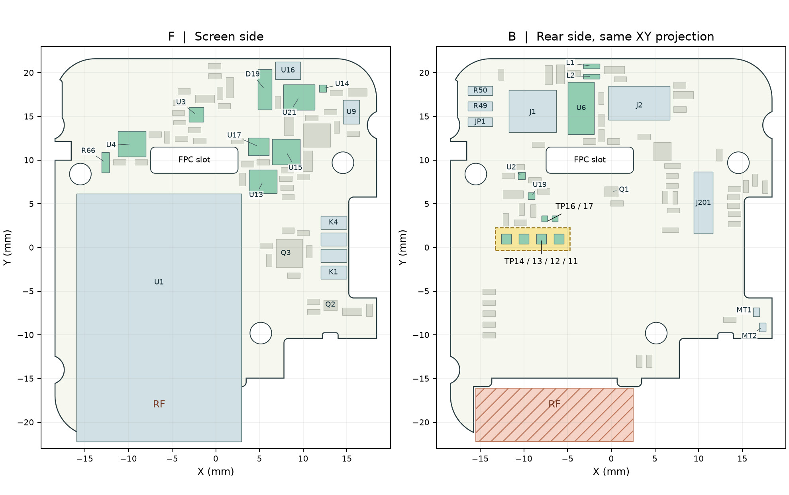

# B-R2 方案三 · 空板布线规划

2026-11-28，供主代理与硬件工程师审批。建议以**屏线从模组背面进 J201、功放和磁珠同在 B 面、传感器总线从模组北边出、烧录针移出北边**这组摆位进入第二步评审。按同一算法，主板二维飞线从 **1328.92 降至 1127.68 mm（−15.1%）**，异网直线交叉从 **565 降至 462（−18.2%）**。槽两侧合计有分流空间。最紧的是 J201 东列贴盘扇出，其次是旧 U1 北缘至槽底的小窗口。全通有可行路径，仍须用连续实铜证明；本次只到规划。

| 基础 | 本次能判定的内容 |
|---|---|
| 源文件 | 授权、六层叠层、完整档实际脚位、电路与固件引脚所有权。基线分支点 `dfe0aba`；方案一 `28dd807`、方案二保底 `sixfix@55fc9dc`。 |
| CAD 回读 | 使用方案二保存的四板焊盘和主板铜、板框、开槽、器件包络。主板 PCB 的 SHA-256 实核为 `3e955c0e8e33d996ea0233792d377ba254a5e523be397fd4cd63992091305d69`。方案二已有闭盖结果只对应此板。 |
| 规划估算 | 拿走所有旧铜与孔，仅保留机械配合和焊盘几何，在内存中重排。截面、二维试摆、飞线及孔预算由下述方法得出。没有生成方案三正式 PCB、网表或固件。 |
| 待核 | 新板 DRC、参考面实铺、同版 STEP 闭盖、针具实物、上电/复位、唤醒、显示/音频质量和 BLE 距离。 |

[批准边界](../../../docs/BASELINE.md#b-scheme3-plan-20261128) · [方案二实际完整档与九版结果](../2026-11-28-full-reroute/README.md) · [逐件试摆](placement.csv) · [逐网层与孔](layer-budget.csv) · [U1 全表](u1.csv)

## 1　固定件把线束挤在哪里

采用装配坐标 mm，+Y 向 J1，F 为屏侧，B 为后盖侧。板外包络 X 为 −18.4 至 18.4，Y 为 −21.1615 至 21.6。中央屏尾槽 X 为 −7.455 至 2.545，Y 为 8.49 至 11.49，宽 10.00、高 3.00。槽西、东两侧各有直径约 2.48 的压紧孔。U1 的东排盘在 X=2.075，J201 西、东两列中心在 X=9.665、11.425。屏座朝向、40 盘及排线穿槽方向均锁定。

**容量算法。** 普通信号按保存工程默认 **0.16 线 / 0.15 隙**，另算已有 0.12 mm 扇出线作为敏感性对照。板级制造下限 0.10/0.10 不作为主通道节距。板边、槽及切孔扣 0.30，天线区全层扣除。外层扣本面焊盘和 0.15 异网间距，并保守避开 U1、J1/J2/J201 和 K 的安装面包络；对面 SMD 不会把内层整块封死。对截面上的每个预留地孔/回流孔，两侧各扣 0.35（普通孔 Ø0.40/钻 0.20，外环半径 0.20＋净距 0.15；内层也取该值）。孔位先避开两面开窗加 0.25，普通孔间留量优于钻边 0.20。对剩余每段净宽 W 独立取 `floor((W+0.15)/(线宽+0.15))` 后求和。L2/L5 始终为地，信号容量为 0。内层过孔钻边至异网铜 ≥0.20，插件孔 ≥0.30；仅 U3.B2 可用 Ø0.26/钻 0.15 盘中孔。表内地孔是留位；最终仍需逐孔找最近地孔。[板级下限](../../boards/b-r2-main/board-rules.json) · [JLC 约束与专网线宽](../../boards/b-r2-main/main.kicad_dru) · [工艺决定](../../../docs/BASELINE.md#b-routing-20261127)

下表容量顺序均为 **F / L3 / L4 / B**。需求分三种读法：封闭端点必须跨过整条切线的下界、指定出口承接的接口线数，以及局部窗口中二维飞线树穿过的不同网数。局部窗口可从端部绕过。相邻截面会数到同一条线，不能把它们累加成整板容量。[各层净宽、地孔坐标与 0.12 mm 复算](cuts.csv)

| 截面和预留地孔数 | 固定件后 → 加入试摆后的 0.16 mm 道数 | 必经需求、分流与判断 |
|---|---|---|
| W 槽西，Y=9.40，X=−18.4…−7.455；3 孔 | 19/19/19/19 → **6/19/19/14** | W+E 合计必须过 23 个非地网，西侧分给 10 个。DAC±、功放 CTRL 靠 B，充电 I2C2 双线靠 F/L3，U4 EN 和粗电源分层。仅靠西侧 F 的 6 道会超载。 |
| E 槽东，同 Y，X=2.545…18.4；4 孔 | 31/31/31/31 → **16/31/31/24** | 承接余下 13 个，包括两条传感器总线线、PPG 中断、ADCIN/MIC_BIAS 和充电/传感器电源。ADCIN/MIC_BIAS 的 L3 带留给模拟，电源沿 F/B 或正交跨越。 |
| S 槽底与模组北侧，X=0，Y=6.15…8.49；1 孔 | **4/5/5/5** → 同 | 试摆直线有 I2C3 两线、CHG_INT、VBAT 共 4 网。F 剩 0.67 和 0.52 mm 两个窗口，若 4 根均为 0.16 可刚好通过；换成粗 VBAT 再放两根控制线就会挤出窗口。优先放 I2C3，VBAT 走电源层/侧翼。 |
| M 模组至屏座，X=6.75，Y=1.30…8.49；2 孔 | 19/19/19/19 → **13/19/19/9** | 投影有 14 网，其中 5 根为串阻后的 CLK/D0–3。B 仅有 9 个标准位，最大的连续余宽 1.38。预分 3 根走 B、2 根走 L4；屏控和触摸从 J201 的另一侧进入。跨整个 U1→J201 的功能链有 8 根屏线、4 根触摸线，不能按 5 根估算全部需求。 |
| N 北边 J1/J2 间，Y=16.25，X=−6.30…−0.05；2 孔 | 15/15/15/14 → **10/15/15/12** | 整板在此 Y 有 18 个非地网须南北相接，J1/J2 之间这个小窗口的直线需求为 5 网（SPK_GND、VBAT、VBUS_5V、VSYS、VSYS_S）。烧录四针和串阻移到槽南，北段优先留给电芯、扬声器及后盖。 |
| J 屏座东侧出口，X=12.05，Y=3.025…6.895；1 孔 | **8/10/10/10** → 同 | 指定东向扇出 **8 个非地网**：13 TE、14 CS、15 RSTB、19 OLED_3V3、20 SDA、21 SCL、22 INT、23 触摸复位。16–18 为地。B 出口有 10 道，绝不能理解成可在盘列内部穿回 10 道。13–15 从南端折回，20–23 在东侧接保护/上拉并错列落孔。 |
| K 表冠西入口，X=11.55，Y=−3.65…3.65；2 孔 | **20/20/20/14** → 同 | 触点端必接 A、B、KEY_N 三个信号及一条 GND。此窗另有触摸 SCL 投影，共 4 个非地网；A/B 和按键分支走 F，触摸退出该带。四个实体和相邻庭院挤占 F，背面还须绕屏座。 |
| Q 西列串阻后，X=−12.8，Y=−10.50…−4.65；2 孔 | **0/15/15/15** → 同 | 5 根串阻后屏线加 1 根 CS 投影。U1 安装面禁止在此横穿，源端就近一次下 B；三条 B 主线及两条 L4 分流，从模组背面横向出去。 |

**槽的硬下界与摆位负担。** 只按用户固定端点，Y=9.40 两侧已有 ADCIN、传感器 SCL/SDA、PPG_INT_N 四网，任意摆位都要过 W 或 E。另保留 JP1/R49/R50 等结构配合后，VBAT 和 OLED_3V3 也跨线。计入全部候选焊盘共 23 网，按每网至少一次分流如下；多分支实际穿越次数还可增加。

| 西 10 网 | 东 13 网 |
|---|---|
| DAC1N/P、功放 CTRL、充电 SCL/SDA、U4 EN、VSYS、VSYS_1、OLED_VBAT、OLED_3V3 | ADCIN、MIC_BIAS、传感器 SCL/SDA、PPG_INT_N、CHG_INT、DOCK_PROTECTED、GS_3V3、U15 输出至 R52 的局部网、U15 EN 负载侧、VBAT、VBUS_5V、VCC_3V3 |

**混合线宽要在同一段里放得下。** W 的 L4 有一段净宽 3.13 mm，可放 0.50 干线、两根 0.35 和两根 0.16，连四道 0.15 间距共 2.12 mm。E 的 L3 有一段 5.85 mm，两根 0.18 模拟线加中间 0.15，再给两侧干扰源各留 1.0，共 2.51 mm。J 的 B 面扣一孔后为 1.59＋1.58 mm；一边 4 根 0.16 需 1.09 mm，另一边 3 根 0.16 加一根 0.35 需 1.28 mm。以上是**单截面**装载，拐弯、信号孔、泪滴、支路及两端的收口仍会进一步耗宽。

**摆位无法消除的两处约束。** J201 盘距 0.35、邻盘沿排方向宽 0.17，余隙仅 0.18 mm，连 0.10 线加两侧 0.10 都需要 0.30 mm。B 面从异网邻盘中间反穿的容量恒为 **0**，换 U1 引脚也打不开这一段。中央槽内部在所有层同样为 **0**。此外 U1 为 F、J201 为 B，12 条显示/触摸功能链每条至少跨一次 F/L3 与 B/L4 参考组。截面没有给出 W+E 全层总量必然超载的证据，真正需要预先绕开的，是上述零容量路线以及把 14 网都塞入 M 的 B 面这种局部安排。

## 2　层与孔预算

F 与 L3 参考 L2，B 与 L4 参考 L5。优先用 F/B 同面接本地器件，L3 的长线优先南北向，L4 的长线优先东西向。转弯时按**实铜**检查 L3/L4 同向异网边距 ≥0.20 mm、交角 ≥70° 和麦克风的更严间距。每次跨参考组先找可配对的 GND 孔，再定信号孔心，目标距离 ≤1.5 mm。多根线可共用一处地孔，逐孔量距；信号孔本体始终贯穿四个走线层。[逐网预算及方案二实数](layer-budget.csv)

| 组 | 主层与允许换层（通孔次数） |
|---|---|
| 屏 CLK/D0–D3、CS/TE/RSTB | 五条 22 Ω 前段 F→B 各 1 孔；后段 CLK/D2/D3 主走 B（名义 0，局部上限 2），D0/D1 在 B/L4 间各 2。三条控制线沿 F/L4/B 各 2、上限 3。源阻两侧分别计网，验收再串成功能链量长度与孔数。 |
| 触摸 I2C1、IRQ、复位 | J201、TVS 和上拉就近 B 汇合。SCL/复位 F→B 预计各 1；SDA/INT 允许借 L3，预计各 2、上限 3。东列先走出焊盘，再落普通孔。 |
| 传感器 I2C3、充电 I2C2、PPG | I2C3 由北排 F 引出，F 串接 U13/U14/U16，L3 过窄段，B 仅收 J2，预计每根 3、上限 5。U3 与 SCL/SDA 上拉在 F，充电两根 F/L3 各 2。PPG_INT_N 由 F 到 J2/R68 的 B 支路，名义 1、上限 3。 |
| 音频和麦克风 | DAC± 从 U1 各下 B 一次，C20/C21、R27/R28、U6 输入同面。滤波前两腿 U6→L1/L2 规定 B、0 孔；滤波后的承流干线 L1/L2→J2 也规定 B、0 孔，表中 SPK_OUTP/N 的孔只给电容等支路。ADCIN、MIC_BIAS 的长线 F/L3/F，各 2 孔、同参考 L2。偏置后段和 MIC_GND 在 U9 旁 F 闭合，L4 磁珠处接系统地。 |
| 电源与电机 | U2→R49 是 ≥0.50 干线，U4/U15 支路 ≥0.30；MOD_VSYS、MOD_SW_OUT ≥0.30，电机回路 ≥0.25，入口 ≥0.40，BTL 滤波前 ≥0.30、后 ≥0.35。主干优先 L4/B，F 面稳压器只作就近接入。VSYS_1 预计 5 孔，GS_3V3 等多分支各按表预算；这些是整网孔数。 |
| 中断、表冠、使能、UART | K1/K3 双相、K2 至 Q3 的按键、马达门控优先 F、名义 0。跨 Q1 或 U2 才换面。两条 ROM UART 从 U1 各下一次 B，R11/12 至 TP13/14、R58 至镊子点留在 B。Hibernate 只接 PA34/44 的实体 AON。 |

**同口径计数。** 保存板有 87 个已接功能网（含 GND）。CSV 逐网列出 61 个信号网、25 个供电/专用回流/承流网以及 GND，保留历史网名。铜段所在层按不同层去重，开路且无铜段记为 0 层。信号实体孔包含单端孔；有效换层孔另算同网孔环在至少两个走线层实际触及铜段或焊盘。跨参考面孔是其中连接两个参考组的非地孔，供电孔也计入。信号及电源分支的多孔不能直接当作一条路径的层数。

| 主板指标 | 方案一 | 方案二保底 CAD | 方案三规划 |
|---|---:|---:|---:|
| 信号网按 0 / 1 / 2 / 3 / 4 层 | 第二步按同口径补算 | 2 / 6 / 26 / 18 / 9 | **0 / 23 / 31 / 7 / 0**，目标 54/61（89%）在 1–2 层 |
| 信号实体孔 / 有效换层孔 | 待同口径回读 | **153 / 146**，7 个单端 | 名义 **59 / 59**，含绕行的信号孔估计 **79–100**，成品目标单端 0 |
| 跨参考面非地孔 / 其中超过 1.5 mm | 177 / 46 | **172 / 40**（111 信号＋61 供电等） | 名义 **63**（32＋31），含绕行约 **80–129**；目标超距 0，例外逐孔交审 |
| 全部通孔 | 380 | **376**（153 信号＋98 供电等＋125 地） | 名义 **228**（59＋57＋112），含绕行估计 **264–301** |
| 现有铜长 / 待连 | 2241.529 mm / 7 | 2187.597 mm / 6 | 全通目标 0 项；实际铜长、待连及 DRC 均待核 |

名义数是按逐网路径和分支预留的设计预算。地孔 112 为初排预算，优先满足 28 个独立去耦地端、模组地和跨参考组配对，再做地缝合。敏感性估算取各类“单网预算上限合计减名义数”的 25%–50% 给绕行（信号余 81、供电余 50、地余 13）；新增非地孔取一半至全部跨参考组，按整孔近似。上限同时用尽会超过这个区间。方案二 I2C3 SCL/SDA（历史网名 I2C1）用 9/7 孔，是第二步首先核对的两根线。

## 3　两面功能布局

两图用同一 XY 投影，读 B 面时不要镜像坐标。蓝灰为固定/保留配合件，绿色为重点试摆件，浅灰为其余器件包络，黄色为四针夹具假定净区。135 件中有 119 件中心移动、31 件换面。JP1/R49/R50 配合测流短接帽，MT1/2 配合电机线束，本案主动保留这五处安装坐标。固定屏座和接口仍有各自的插拔/操作预留。[全部面别、中心、朝向及高度](placement.csv)

| 功能块 | 规划位置（装配 X,Y；角度按 KiCad）与取舍 |
|---|---|
| 北部音频 | **U6 B(−3.45,15.95) 180°**，输入朝南、输出朝北；L1/L2 在 B(−2.25,20.75/19.57) 0°，同向、节距 1.18。R27/R28、C20/C21 同在 B，避开方案二两个开路输入。U6 模型高 1.10，包络南缘 Y=12.958，在电池投影北沿 Y=10.10 以外。优先核后盖柔板、J2 压口和 BTL 滤波后去 J2 的并行弯。 |
| 电池、充电与受控轨 | **U3 F(−2.25,15.20) 0°**，A 行朝北、C 行朝南向模组；U17 F(4.90,11.55) 90°、D19 F(5.60,18.10) 90°靠 J2.10。**U4 F(−9.60,11.85) 0°** 移到槽西、R66 F(−12.65,9.75) −90°，靠 C10 与 R49/R50。U15 F(8.05,10.95) 180°在槽东、C33 同面。U2 B(−10.25,8.20) 0°、U19 B(−9.15,5.90) 90°贴近模组供电/服务端。U4/U15/U21 三颗高 1.45 的器件均在屏侧。 |
| 屏与触摸 | R18/19/20/16/17 按 CLK/D0/D1/D2/D3 顺序在 B、X=−14.00、0° 排开，与 U1 西列对位。J201 西列收五根阻后线，东侧 D5–D8 及 R46–48 均放 B。固定排线和槽形成两组独立入口。 |
| 传感器、后盖、麦克风 | **U13 F(5.40,7.55) 180°** 在槽东入口，U14 F(12.25,18.20) 90°、U21 F(9.55,17.20) 0°靠 U16 与后盖支路。U9 保持 F(15.50,15.50)，C26/C27、R30、L4（磁珠位号）在其附近同面。麦克风从 U1 的专用西列经 L3 安静带进入东北；实布要给 ADCIN/MIC_BIAS 的连续参考及偏置/回流闭环让路。 |
| 表冠、电机与服务 | Q3 F(8.40,−0.65) 90°邻 K2；R62/R63 在 F 分别就近接 A/B。Q2 F(13.10,−6.60) 0°靠 MT1/2，门控与大电流环在东南。四针放在 U1 投影下 B 面、槽南，镊子点和 R58 在旁。 |

**飞线对照方法。** 用方案二完整网名与实际盘心；每网构欧氏最小生成树，包含所有供电网、局部地/专用回流，排除公共 GND、NC 和未连接盘。按位号排序、保留盘序，以“距离、起点序号、终点序号”裁决等长边。加总二维树长，并数不同网直线段内部相交的对数（不算端点接触、同网或共线重叠）。同 XY 异面仍须过孔，长度指标只算 XY。二为 **1328.92 mm / 565 对**；仅换摆位、仍用二的接脚为 **1136.71 / 491**；再按第四节换脚为 **1127.68 / 462**。两者分开可看到改善主要来自器件摆位。跨层重叠和避障绕行使这两个量无法直接换算成铜长、噪声或最终 DRC。

**机械证据边界。** 用 16.845 mm 薄装配原 FCStd，在主板 Z=8.41/9.21 两侧以 0.05、0.65、0.80、0.96、1.20、1.70 mm 高度分带求实体截面，试摆选不低于器件高度的一档。放置时用本体/焊盘矩形包络，保留同面间隙、天线区与接口操作区，对框、压紧件、屏尾相关实体留横向余量；B 面叠加电池和上移 0.50 的可选 NTC。此筛选只到高度分带，U9 声孔、U16 光导、R66 两端返修口、走线/电池拆出动作及针具仍待同版 STEP/实物复核。方案二闭盖为 0 违规、最小横向 0.31999，电池投影内最高 0.960 mm。[闭盖检查代码](../../generator/kicad_fit.py) · [薄装配](../../../mechanical/b-enclosure/2026-11-25/B-thin-assembly/README.md)

## 4　模组、表冠、后盖和烧录接口

逐盘表覆盖 U1 全部 68 盘。对照取 `sixfix` 的实际焊盘。11/28 初案曾列“表冠 B=PA24、触摸复位=PA32”，完整档实施后已经对调。本方案沿用实际 **表冠 B=PA32、触摸复位=PA24**。历史 PA 字样保留作逻辑网标识，固件按下面的实体 PA 配置。[U1 全部 68 盘](u1.csv) · [对照生成源](../../generator/module_pins.py)

| 信号/对象 | 方案二完整档 → 方案三建议 | 收益、固件或跨板影响 |
|---|---|---|
| 传感器 SCL | U1.8 PA40 → **U1.24 PA30**，释放 PA40 | 从东列 Y=−7.40 移到北列 Y=5.275；同一新摆位联合 J2 换序后，该网树长 37.47→32.05 mm。仍用 **I2C3_SCL**，清除旧 BSP、Product/OTA 上对 PA30 的开轨写高，U15 EN 归 PA25。 |
| 传感器 SDA | U1.9 PA39 → **U1.25 PA31**，释放 PA39 | 新摆位 34.65→32.04 mm。仍用 **I2C3_SDA**，清除 PA31 旧 IMU INT1/腕动 IRQ、GPIO/AON 注册，IMU 中断仍为 PA36。在所有入口迁移复用、租约、睡醒恢复和关轨前撤上拉。PA39/40 为手册建议的 I2C 区，改用 PA30/31 的边沿、负载和掉电反灌需实测。 |
| 触摸、充电、显示 | 触摸 I2C1 SDA/SCL PA33/37、INT PA41、RST PA24；AW32001 I2C2 SDA/SCL PA28/29；LCDC PA00、02–08 全保留 | 分别对应 RT 的 `i2c1/2/3` 三条总线（触摸/充电/传感器），无驱动实例或器件地址迁移。完整档已要求撤掉 PA24 的 TF/PBR 输出占用、PA28/29 的 TF 配置；OLED 复位与触摸复位各自保留。 |
| 表冠、马达、IRQ/EN | 表冠 A/B=PA35/32，马达=PA38，功放=PA11，IMU INT1=PA36，PPG INT=PA27，U2/U4/U15 EN=PA20/26/25 | 冠保留同一 **ATIM1_CH1/CH2** 或双沿 GPIO，马达预留 **GPTIM2_CH1**。DEEP 前如需冠唤醒切 GPIO，醒后恢复相位；马达先预装 LOW，清旧屏/启动写 PA38；PA11 按 NS4150B 控制。U13 相对方案二转了 90°、U14 也转了 90°，须分别按封装坐标修正 IMU/磁力计到表体的轴矩阵，三轴符号、航向和抬腕实物确认。 |
| 固定/保留 | PA34 按键=AON10、PA44 VBUS=AON20；ROM PA18 RX / PA19 TX；专用 DAC/MIC/模拟脚、地电源、PA22/23、内排 PA12–17 均沿用 | 只为 PA34/44 保留 Hibernate 引脚唤醒；PA28–33 的专用 AON 接线断开，普通 GPIO 的 DEEP IRQ 走 WSR_GPIO1。U3 CHG_INT 经 Q1，不能凭固件增加独立 IRQ。PA21 无外接盘。PA34 长按、PA44 分压、掉电安全和 ROM 下载须实测。 |
| K1–K4（由南向北） | **A/GND/B/KEY_N → A/KEY_N/B/GND** | K2 靠 Q3，KEY_N 树长 6.19→4.73 mm，PA34 仍在 Q3/R34 后。A/B 相序、电气极性与定时器归属相同。实施时 K2↔K4、水平板 P2↔P4 与 JC12↔JC14、立板 JC2↔JC4 同步，ENC1 的 S1=KEY_N、C/S2=GND，A/B 各回原端。核四触点导通并验证转向、按键。 |
| J2/JF1（1…10 同号配对） | **SPK_OUTP、SPK_OUTN、PPG_GND、GS_3V3、PPG_1V8、PPG_INT_N、SCL、SDA、DOCK_RTN、DOCK_5V_IN** | 6/7/8 原为 SCL/SDA/INT，现为 **INT/SCL/SDA**，其余同号沿用。9 在主板是 GND，在柔板是 /DOCK_RTN；3 是 PPG_GND。保留 BTL 相邻、充电 9/10 相邻。固定新 U1 脚比较 6–8 六种排列：选中顺序使主板树长少约 0.22 mm、交叉多 1，对后盖少 2 对交叉（29→27）；PPG_INT_N 单网约多 0.46 mm。选择理由是两板合计和成对出线。JF1 全网名同步，U301.2/.3/.13 仍分别为 SCL/SDA/INT，设备地址、总线号不变。新旧尾排不能混装。 |
| TP11–14 | 原 B 面 Y=20、X=−3/−5/−7/−9 → **B 面 Y=1.00、X=−6/−8/−10/−12** | 保持原针序 **GND、MOD_VSYS、UART_RXD、UART_TXD** 和 2.00 mm 中心距。R11/R12 也在 B；四个 UART 串阻前后网的树长合计 44.06→8.38 mm。ROM 和串口驱动无变化，治具定位、图纸和 TX/RX 对接标识须更新。 |
| TP16/17 | B(−7.60,0.40)/(−8.80,0.40) → **B(−7.65,3.30)/(−6.45,3.30)** | 16 仍为 RTS_N_OD，17 仍为 GND，R58 和 U19 同面。两盘 Ø0.70、中心距 1.20、边距 0.50 mm，开窗无钢网。最近其它 B 面器件包络约 0.625 mm。与四针均在**露出主板 B 面**的维修工况操作，约 0.5 s 短接复位，固件无新增脚。 |

四针矩形净区取 X=−13.25…−4.75、Y=−0.30…2.30（8.5 × 2.6 mm），只留针盘；区外最近器件包络 R11 距区边 0.176 mm、高 0.65 mm，最近高度 ≥0.95 的 R1 距区边 3.368 mm。此尺寸为夹具设计假设，针套外径、横梁宽度、对位误差和 B 面支撑实物待核。正式生成/闭盖脚本原先以旧 DBG0–3 为空间锚，须同步移动针具实体后再验，不能跳过原守卫。

SDK 依据为主检出 `D:/MY_Desk/project/wristflow/vendor/SiFli-SDK`，实核 `v2.5.1@421126d9`。见其 `drivers/cmsis/sf32lb52x/bf0_pin_const.c:998–999`、`drivers/hal/bf0_hal_pinmux.c:625–675,677–739,800–859,1077`、`docs/source/zh_CN/app_note/low_power.md:127,1092`。Product 现有 `prepare_bus` 会配置 PA39/40 并把 PA30 当电源 GPIO 拉高；若沿用会占用新 SCL。实施时逐个核冷启、休眠恢复、OTA loader、IMU/ALS/地磁与充电租约。工程师如决定继续用推荐的 PA39/40，可保留布局和接口，回到东列走 I2C3 的备选须重算走廊。[SDK 锁](../../../sdk.lock.json) · [现有 IMU 总线](../../../apps/product/src/product_imu_diag.c#L598) · [腕动 IRQ](../../../apps/product/src/product_wrist_irq.c#L57) · [充电租约](../../../apps/product/src/product_charger_bus.c) · [OTA 启动](../../../apps/ota_loader/src/startup.c)

## 5　全通判断、先后次序与待确认项

方案二的六个断点在九版分区实验中各自有局部解，但分区组合会打断邻网。本案把两个功放输入带到同面，把 PA25→R54/U15 与 PA27→J2.6 放进北部规划，给 K3→PA32 留 F 通路，给 PA24→J201.23 留独立的东向出口。因此建议批准**整板从空铜试布**。截至本步，主板的全通、上述孔数、无例外回流以及全部机械门限同时成立，仍属待核；三块小板也要按各自的接脚和拓扑分别验。

| 第二步最难的五处 | 先做的检验，及失败时的局部处理 |
|---|---|
| J201 东列和屏线 | 先扇 13–15、19–23 及地脚，保留独立回流，再布五条阻后线；0.35 排距的相邻孔错列，按钻边/开窗检查。复量五路及 CS/TE/RSTB 的连通、长度、孔、实铺缺口和异网反焊盘穿越。保底五路各 3 孔、最大长差 10.442 mm、穿越 0。出口不够先把较低速的控制从另一端绕，不动屏座。 |
| B 面 U6、J2 与后盖 | 先走 U6.5/.8→L1/L2，再走 B 面滤波后 ≥0.35 两腿至 J2.1/.2。以新出脚方向重定分段截线，报告出脚/并行/入珠、并行段争取 ≤0.8 mm，分瓣面积对比 4.628 mm²；滤后中心距 ≤0.60、环面积 ≤10 mm²。D1/D2 至 J2.2/.1 的盘心直距 1.75/2.10，铜路均须 ≤3。优先旋转/平移磁珠对；若工具/闭盖无空间，再试 U6 屏侧及一对同步跨面。 |
| 槽两侧的粗电源与模拟 | 先留连续模拟/回流带；同层或无遮蔽地层时，对列名干扰源同向边距 ≥1.0、交角 ≥70°，对同层干扰孔/盘 ≥0.30。核充电入口两段 ≥0.40 且各 ≤15 mm，U17.1→C2.2、D17.3 及 U17.8→C42.2、U15.1→C33.2 各 ≤3。试摆四对 XY 直距依次 1.05/0.55/1.75/1.98 mm。首摆 D17 与 U17 输入盘正反重合，盘外逃线余量小；把 D17 转 180° 并南移 0.60 后，在 (5.7525,10.3500) 找到普通孔试位。两面 0.30 线的直段合计 1.459 mm，检查了盘、开窗与异网间距，候选配对地孔 (4.7025,10.3500) 相距 1.05 mm。转角、泪滴及实铺复验留在第二步。 |
| U3 九球、北边总线与地 | 保留唯一 B2 盘中孔，九球不开异网铜、同网开窗铜面积 ≤1.15 倍盘面积，U3 半径 1 mm 内 L2 覆盖 ≥60%。L2/L5 各为单片 ≥1020.551 mm²，普通空洞 ≤5 孔且长边 ≤3.5，机械开口额外缺铜 ≤0.5 mm²，边缺深度 ≤0.80。28 个去耦地端逐件检查独立地孔，C2 地端 ≤0.70、C33 ≤0.80。孔有冲突优先移动同面上拉/支线，逐网重算 I2C3 的换层与回流。 |
| 夹具、测流与闭盖 | 以新针区和实体针套做接近/受力检验，保留 R66 两端各 1 mm 的返修入口、C41/C42、U9 声孔、U16 光导、J1 导线及天线避让。新板同版闭盖碰撞 0、横向 ≥0.31999 mm、电池投影内 B 高 ≤0.960 mm、至隔片 ≥0.70、可选 NTC 上移 0.50 后净距 ≥0.20。先挪受阻的可移件，再回读，夹具不满足则调针区。 |

**请主代理 / 硬件工程师确认三项。**

1. 是否采用 PA30/31 的 I2C3、K2/K4 对调及 J2/JF1 的 6–8 顺序。三者分别影响固件旧引脚写入、表冠两板和后盖备件兼容。若批准，四板按（位号、盘号、完整网名）列预期差分，包括同网不同局部标签与 NC。
2. 针具实际外廓、定位基准和 B 面支撑能否使用 8.5 × 2.6 mm 净区；以及 R66 测流短接和 U6 所在北部后盖空间能否接受这个维修布局。四针和镊子对位置仍可在规划边界内调整。
3. 是否同意先验证 J201 东扇出和 B 面功放这两处，再展开整板。工程师审查跨参考面例外、PA34 低电压按键裕量及上电默认电平；若将来考虑共用触摸/显示复位或自动复位，需要单独的电路及时序决策，本案按现有独立电路预留。

主代理确认后，先从生成源改四板的接口与位置并回读网表，更新检查器中的物理脚号、DBG 针位及 BTL 分段坐标，沿用原数值门限。后盖 FPC、表冠立板、水平触点板在方案二各余 20/5/4 项待连，三板分别出 XML、导通与待连记录，防止把主板全通误作跨板全通。再从空铜布整板、实铺、检查 35 条供电/扬声器路径、28 个去耦回路、钢网/填孔盖帽、U3 与天线、同版 STEP。与方案一/二并排报完整板待连、原理图一致性、全部 DRC（固定 K 庭院三对列明）、锐角、短段和泪滴、铜长、各层地、QSPI/BTL/麦克风、闭盖、逐网孔及层分布。成品目标待连/一致性差异/锐角/单端孔均为 0，去除无意义的 <0.12 mm 短段，生产开口与改位后焊盘逐项匹配。分区中间指标可暂时变差。[方案二逐项对照](../2026-11-28-full-reroute/README.md#zone-results) · [专项检查入口](../../generator/kicad_layout_check.py)

### 回读与复核

本机只读输入为方案二工作树 `artifacts/routing2/sixfix/WristFlow-B-R2/{geometry.json,fit.json,WristFlow-B-R2.kicad_pcb}`、同批三小板的 `geometry.json`，以及主检出 `artifacts/wristflow-b-source-review-20261124/2026-11-25/B-thin-assembly/` 的原装配。旧 CAD 版本 KiCad 10.0.8 / FreeCAD 1.1.4。本次 FreeCAD 1.1.4 抽取薄装配高度投影，Shapely 2.1.2 做几何筛选。按旧面局部化焊盘，换面镜像局部 Y，再用候选角度旋转和平移。孔计数核对同网焊盘及各层孔环与铜段的实际接触。

本工作树的临时估算在忽略目录 `artifacts/scheme3-study/`。依次运行 FreeCAD Python 的 `-B shadows.py`、带 Shapely 的 Python 的 `-B study.py`、`-B cuts.py`、`-B output.py` 和 `-B figure.py` 可重读本机输入。无需这些临时脚本也可按 [placement.csv](placement.csv) 的坐标、[cuts.csv](cuts.csv) 的分段净宽与 [layer-budget.csv](layer-budget.csv) 的单网记录复算本报告。新摆位尚未走线，固件未编译，自研板无实物验证。
